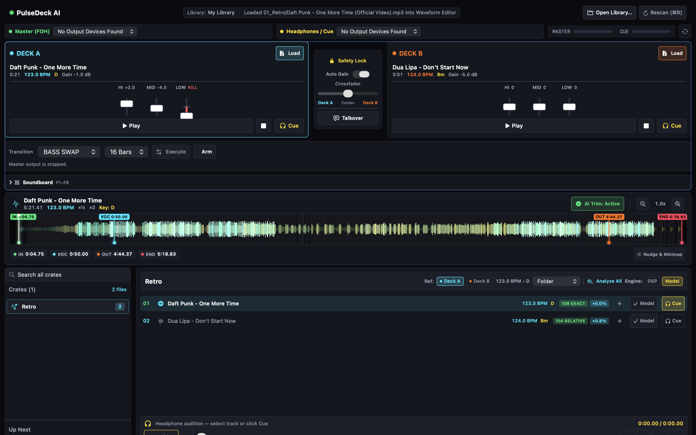
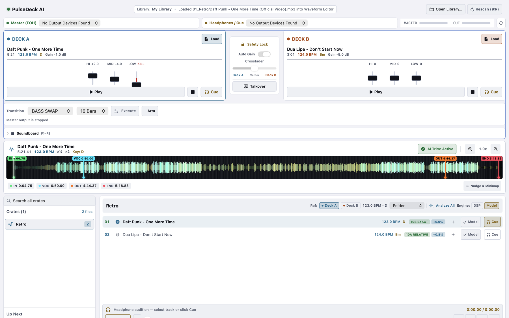

# PulseDeck AI

A two-deck DJ app for macOS, written in Swift 6 and SwiftUI. It analyzes your music on the Mac, lines up the beats, and mixes one track into the next without a network connection.



<details>
<summary>Light appearance</summary>



</details>

## What it does

- **Two decks, two outputs.** Speakers (Master) and headphones (Cue) run as separate audio engines, so you can preview the next track without it leaking into the room.
- **Understands your tracks.** A bundled Core ML beat model ([Beat This!](https://github.com/CPJKU/beat_this)) finds beats and bars; key detection gives Camelot keys; loudness is matched to about -14 LUFS.
- **Mixes for you.** Bass Swap, Echo Wash and Hard Cut transitions snap to the bar. Tracks at half or double tempo are matched. Auto-Pilot starts the mix at the cue you set.
- **Helps you pick.** Best match ranks the library by key and tempo, Up Next keeps a queue (it survives a restart), a bridge track can be suggested when two songs clash, and tracks you already played tonight are marked.
- **Event extras.** Eight-pad soundboard (F1-F8), talkover ducking (T), a projector window with spectrum, slideshow and now-playing screens, and a Safety Lock against accidental track swaps.
- **System, Light or Dark** appearance (View > Appearance). The projector always stays dark.

## Install

1. Download the DMG from [Releases](../../releases) and drag **PulseDeck AI** to Applications.
2. The app is signed ad hoc, not notarized. On first launch macOS may say it cannot be opened: right-click the app, choose **Open**, then **Open** again (or System Settings > Privacy & Security > **Open Anyway**).
3. Needs macOS 14 or newer on Apple Silicon.

Build it yourself instead:

```bash
swift build -c release
swift run PulseDeckAI            # run from the package
scripts/package_app.sh           # builds dist/PulseDeck AI.app and a DMG
```

## First steps

1. **File > Open Library...** and choose a folder with one subfolder per crate (genre, night, mood). Audio files can be mp3, wav, flac, m4a, aiff or aac.
2. Press **Analyze** on a track (or **Analyze All** for the crate). Results are cached next to the library in `.pulsedeck_ai_cache.json`.
3. Select a track and **Load** it on Deck A or B, choose a transition and length, and press **Execute** or **Arm** for Auto-Pilot.

The full keyboard map and event tips are in the [user manual](docs/USER_MANUAL.md).

## Known limits

- Beat positions come from a model that works in 20 ms steps, so a beat can be about 10 ms off. That is fine for a bass swap, but not sample-accurate.
- Tracks with a drifting tempo (live recordings) are not good beat-match candidates. A slow track in 12/8 can be reported at three times their feel tempo.
- Master and Cue on one output device (for example only the built-in speakers) works, but audition is then heard in the room.
- Replugging headphones during a set is not fully verified on real hardware (issue #60).
- The optional cloud advisor (Gemini) is experimental and off unless you add a key in Settings.

## How it is built

| Part | Folder |
| :-- | :-- |
| App, UI, view models, projector | `Sources/PulseDeckAI` |
| Audio engines, analysis, transition planner, cache | `Sources/PulseDeckCore` |
| Lock-free ring buffer for audio-thread metering (C11) | `Sources/PulseDeckAtomics` |
| Optional Python tools to validate and batch-analyze the cache (extra packages in `requirements-analysis.txt`) | `scripts/` |

Design notes (dual engines, audio-thread safety, latency, cache format) are in [docs/TECHNICAL_ARCHITECTURE.md](docs/TECHNICAL_ARCHITECTURE.md).

```bash
swift test                                   # about 490 tests, ~65 s
python3 -m unittest discover -s scripts/tests -q   # Python companion tests
```

## Credits

Beat tracking uses the Beat This! `small0` model by Francesco Foscarin, Jan Schlüter and Gerhard Widmer (MIT). See [THIRD_PARTY_NOTICES.md](THIRD_PARTY_NOTICES.md).
