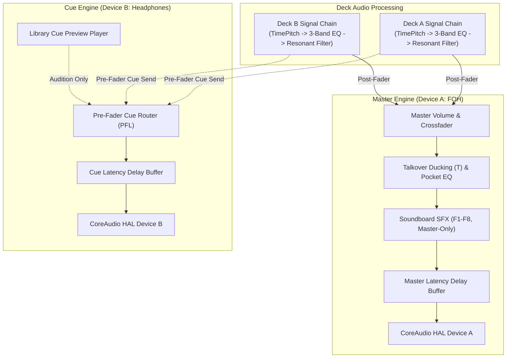

# PulseDeck AI

> **Intelligent Dual-Engine DJ Performance System for macOS**  
> *Engineered natively in Swift 6 and SwiftUI for Apple Silicon (MacBook Pro M1 Pro / 16GB baseline).*

---

## Overview

PulseDeck AI is a professional, high-reliability DJ performance workstation designed specifically for live event, wedding, and mobile DJs on macOS. Built from the ground up to take full advantage of Apple Silicon unified memory architecture and CoreAudio real-time guarantees, PulseDeck AI bridges traditional hands-on dual-deck DJ performance with offline DSP analysis, automated performance transitions, RAM-preloaded soundboard SFX, secondary video projector visuals, and hybrid artificial intelligence advising.

Unlike consumer playback tools or bloated cross-platform DJ suites, PulseDeck AI adheres to strict real-time audio engineering principles:
* **Dual Independent Output Engines:** Completely segregated CoreAudio output pipelines for Master Front-of-House (FOH) and Cue (Headphones) monitoring without aggregate device clutter.
* **Strict Output-Only Guarantee:** Absolutely zero interaction with audio input hardware (`engine.inputNode`). Preserves high-fidelity Bluetooth A2DP audio codecs and eliminates the risk of feedback loops or OS microphone privacy interrupts.
* **Deterministic Real-Time Safety:** Render callbacks execute free of heap allocations (`malloc`), locks, mutexes, Swift runtime actor hops, or Objective-C ARC retain/release cycles.
* **Protected Human DJ Provenance:** High-precision automated DSP cue analysis that never clobbers manual user adjustments, backed by atomic file persistence.
* **Performance Macro Automation:** Bar-aligned transitions (Bass Swap, Filter Echo Wash, Hard Cut), Auto-Pilot state machine, Master talkover ducking (`T`, 800ms linear ramp to 0.15 linear gain with vocal pocket EQ), and 8-pad zero-I/O RAM soundboard (`F1`–`F8`).
* **Secondary Projector Visuals:** Dedicated presentation window (`Cmd + Shift + P`) offering 24-band FFT spectrum visualizer, Ken Burns photo slideshow and muted video loops, Now Playing card with event banner, and blackout screen.
* **Hybrid Intelligent Advisor:** Offline-first vDSP feature extraction augmented with an optional, rate-limited Google Gemini (`gemini-2.5-flash`) cloud advisor or local Ollama (`localhost:11434`) model.

---

## Hardware & Runtime Requirements

| Parameter | Specification | Notes |
| :--- | :--- | :--- |
| **Hardware Baseline** | MacBook Pro 14" / 16" (M1 Pro, 16GB Unified Memory) | Baseline development and benchmarking platform |
| **Operating System** | macOS Sonoma 14.0 or newer | macOS 14+ required for Swift 6 structured concurrency |
| **Language & Toolchain** | Swift 6.0 (`swift-tools-version: 6.0`) | Strict concurrency checks (`.swiftLanguageMode(.v6)`) |
| **Frameworks** | AVFAudio, CoreAudio HAL, Accelerate (vDSP), SwiftUI, AppKit | Native Apple frameworks only (zero third-party binary blobs) |
| **Python Companion** | Python 3.10+; standard library for validation, optional `librosa`/`soundfile` for batch analysis | Analyzer dependencies live in `requirements-analysis.txt` |

---

## System Status & Delivered Capabilities

PulseDeck AI is developed through a verification-driven lifecycle. The core performance engine, audio graphs, offline DSP, UI, transitions, soundboard, and projector visuals are fully implemented and verified on `main`:

### Implemented & Verified Capabilities
* [x] **Dual Independent CoreAudio Output Pipeline (Phase 1):** Segregated `masterAudioEngine` (FOH speakers) and `cueAudioEngine` (headphones) running output-only graphs, 3-band isolator EQ, dual-pole resonant sweep filters, and C11 lock-free SPSC output metering.
* [x] **Offline DSP & Unified Cache Schema v1.0.0 (Phase 2):** Accelerate vDSP feature extraction, beat grid estimation, 4 bounded cue markers, Camelot wheel harmonic key detection, atomic file persistence (`.pulsedeck_ai_cache.json`), override preservation, and Gemini 2.5 Flash / Ollama hybrid advising.
* [x] **Interactive Waveforms & Library Audition Engine (Phase 3):** 60 FPS multi-band SwiftUI Canvas waveforms with frequency-color mapping, 4 draggable cue handles (`startTrimCue`, `vocalEntryCue`, `mixOutCue`, `endTrimCue`), `I`/`O` hotkeys, `Y` AI trim bypass, non-destructive cue playhead scrubbing, and dedicated headphone Cue preview player with beat-step stepping.
* [x] **Performance Transitions, Auto-Pilot, Talkover & Soundboard (Phase 4):** Quantized Bass Swap (`B`), Filter Echo Wash (`W`), Hard Cut (`C`), Auto-Pilot mix engine (`Shift + A`), Master Talkover Ducking (`T`, 800ms linear ramp to 0.15 Master music level with -4 dB 300 Hz–3 kHz mid dip, SFX bypass), and 8-pad zero-I/O RAM Soundboard (`F1`–`F8`) with procedural synthesized fallbacks, choke-self retrigger, polyphonic overlap, and strict Master-only routing with Cue isolation.
* [x] **Secondary Projector Presentation Window (Phase 5A):** Dedicated fullscreen-capable external window (`Cmd + Shift + P`) supporting 4 presentation modes on Keys 1–4 (24-band FFT visualizer, Ken Burns photo slideshow and muted video loops with 48 MB / 20 photo RAM cache and idle fallback, Now Playing & customizable event banner, and true blackout). Includes first-responder text editing protection, display disconnect fallback, and strictly muted videos (`volume = 0.0`).
* [ ] **Master Deck Safety Lock (Phase 5A — Pending Merge):** Protects playing on-air decks on the audio control queue during playback and crossfades from accidental pauses, stops, seeks, or track loads. `Shift + Space` provides a one-shot pause override. Fully developed and reviewed in PR #19, pending merge into `main`.
* [ ] **Final Documentation Polish (Phase 5B — In Progress):** Complete user manual, architectural specification, continuation tracking, and phase status.

---

## Architectural Highlights

### 1. Dual Independent Output Engines (Output-Only)
PulseDeck AI initializes **two entirely independent `AVAudioEngine` instances**:
1. `masterAudioEngine`: Assigned to the primary Front-of-House CoreAudio device (speakers / PA system).
2. `cueAudioEngine`: Assigned to the secondary CoreAudio device (DJ headphones).



> [!IMPORTANT]
> **Strict Output-Only Policy:** PulseDeck AI **never** accesses `engine.inputNode` on either engine. Accessing `inputNode` triggers macOS microphone permission prompts, degrades Bluetooth A2DP audio connections into low-fidelity bidirectional telephony mode (HFP/SCO @ 8kHz/16kHz mono), and introduces acoustic feedback risks in live DJ venues.

### 2. Real-Time Audio Thread Safety
To eliminate audio dropouts, glitches, and priority inversion:
* **Render Callbacks:** Strictly forbid `malloc`, `free`, class instantiation, Objective-C/Swift ARC retains/releases, file I/O, network sockets, or OS locks (`os_unfair_lock`, `pthread_mutex`).
* **Inter-Thread Communication:** Bounded Single-Producer Single-Consumer (SPSC) lock-free ring buffers and atomic variables transfer metering and playhead data from the audio thread to `@MainActor` UI components.
* **Graph Topology Changes:** Reconfigurations (node connections, device reassignments) are strictly serialized on a private background audio queue (`com.pulsedeck.audio.graph`).

### 3. Master / Cue Latency Compensation & Bluetooth Constraints
Because physical latency cannot be negative, latency alignment within $[-300\,\text{ms}, +300\,\text{ms}]$ is achieved by delaying the faster audio path:
* **Master Lags Cue ($offset > 0$):** We inject positive delay into the **Cue path**.
* **Cue Lags Master ($offset < 0$):** We inject positive delay into the **Master path**.
* **Bluetooth Audio Limitations:** Wireless Bluetooth audio inherently introduces variable, device-dependent buffer latency and independent hardware clock drift across different headphone chipsets, codecs, and RF environments. While PulseDeck AI provides calibration delay compensation and advisory indicators, physical sample-accurate cueing and scratch beatmatching require wired CoreAudio outputs (USB DAC or 3.5mm jack).

### 4. Cache Schema & Human DJ Provenance Protection
The library cache file (`PulseDeck_Library/.pulsedeck_ai_cache.json`) defines four strictly bounded cue timestamps:
$$\text{0.0} \le \text{startTrimCue} \le \text{vocalEntryCue} \le \text{mixOutCue} \le \text{endTrimCue} \le \text{duration}$$

When a human DJ manually adjusts cues, BPM, or musical key, the track entry records `manualOverrides.isManual = true` along with the list of overridden fields. Re-running automated DSP analysis or re-scanning the library will **never** overwrite manually adjusted fields.

### 5. Interactive Waveforms & Non-Destructive Cue Editing
The multi-band Canvas waveform visually differentiates audio frequencies:
* **Red / Amber:** Low frequencies ($20\text{--}250\,\text{Hz}$) — Bass drums, 808 subs, basslines.
* **Green:** Mid frequencies ($250\text{--}3500\,\text{Hz}$) — Lead vocals, snares, guitars.
* **Teal / Blue:** High frequencies ($3500\text{--}20000\,\text{Hz}$) — Hi-hats, cymbals, air.

> [!NOTE]
> **Non-Destructive Cue Playhead:** The cue editing playhead in the waveform editor is strictly isolated to cue point positioning and visual scrubbing. It **never** seeks or interrupts live Master audio playback.

### 6. Automated Transitions & Auto-Pilot Engine
* **Bass Swap (`B` Key):** Aligns to downbeats, cuts outgoing bass while swapping incoming bass, and smoothly crossfades mid/high frequencies over 16 bars.
* **Filter Echo Wash (`W` Key):** Sweeps outgoing high-pass filter upward into an echo wash, executes an equal-power crossfade, and drops the incoming track on the 1.
* **Hard Cut (`C` Key):** Quantizes to the upcoming bar boundary and cuts instantaneously ($0.0\,\text{ms}$) from Deck A to Deck B.
* **Auto-Pilot (`Shift + A`):** Evaluates `mixOutCue`, selects harmonic transition strategies, aligns beats, and triggers transitions automatically.

### 7. Master Talkover Ducking (`T` Key)
* **Linear 800ms Ramp:** Smoothly reduces Master FOH music output **to** 15% linear amplitude (0.15 multiplier, ~-16.5 dB) over an 800ms linear ramp.
* **Vocal Pocket EQ:** Carves a -4.0 dB parametric notch across 300 Hz to 3 kHz for clean MC/DJ vocal intelligibility.
* **SFX Bypass:** Master-only Soundboard drops bypass the ducking stage downstream, punching through at full volume during announcements.

### 8. RAM-Preloaded Soundboard (`F1`–`F8` Keys)
* **Zero-I/O Triggering:** Discovers up to 8 SFX assets from `PulseDeck_Library/08_Soundboard_SFX` in alphabetical order, pre-decoding and converting them into canonical 44.1 kHz, 32-bit Float, stereo RAM buffers during library startup.
* **Procedural Synthesized Fallbacks:** Missing, corrupt, unsupported, or oversized (>15s / 12MB) files safely fall back to pre-synthesized musical procedural buffers (1 kHz stinger, 808 kick, noise snare, chime, rimshot, siren, laser, airhorn).
* **Polyphonic & Choke-Self Retrigger:** Independent pads overlap polyphonically without cutting each other or deck music off. Retriggering the same pad cuts and restarts that pad monophonically (choke self).
* **Master-Only & Cue Isolation:** Connected to `soundboardMixerNode` feeding `masterAudioEngine.subMixer`. Zero soundboard signal reaches Headphone Cue.
* **macOS Function Keys:** On Apple keyboards, hold `Fn` (or Globe) while pressing `F1`–`F8`, or configure standard function keys in macOS System Settings.

### 9. Secondary Projector Window (`Cmd + Shift + P`)
* **Mode 1 (`Key 1`):** Real-time 24-band FFT audio spectrum visualizer consuming published output meter frames with smooth decay on silence.
* **Mode 2 (`Key 2`):** Ken Burns photo slideshow and muted video loops from `PulseDeck_Library/09_Visual_Backgrounds_Media` with a 48 MB / 20 photo RAM cache, honest idle fallback, and strictly muted `AVPlayer` instances (`volume = 0.0`).
* **Mode 3 (`Key 3`):** Now Playing track metadata card with active song title, artist, BPM, musical key, and customizable event banner.
* **Mode 4 (`Key 4`):** True blackout canvas (`Color.black`) with zero light or controls leaking onto the audience display.
* **Contextual Protection:** First-responder text editing guards ensure keys 1–4 are never stolen while typing event banner text. Automatic external display selection falls back safely on disconnect.

### 10. Master Deck Safety Lock [Pending Merge — PR #19]
* **Default-On Live Protection:** Enabled by default. Protects any loaded deck actively broadcasting to Master with nonzero channel or crossfader gain.
* **Control Queue Authority:** On-air membership is evaluated synchronously on the audio control queue, protecting both decks during crossfades.
* **Guarded Actions:** Manual pause, stop, track load, and live playhead seek commands are intercepted and rejected while locked.
* **One-Shot Override (`Shift + Space`):** Pressing `Shift + Space` allows a one-shot pause of the focused on-air deck without clearing persistent lock protection.
* **Automation & Cue Exceptions:** Automated transitions, headphone Cue audition, and non-destructive waveform cue editing are completely exempt from manual transport locking.

### 11. Hybrid Advisor Safety & Rate Limiting
* **Primary Provider:** Google Gemini API configured for `gemini-2.5-flash`.
* **Rate Limiting:** A rolling window limits cloud attempts to 12 requests in any 60 seconds with bounded exponential backoff.
* **Local Fallback:** Optional local Ollama runs at `http://localhost:11434` for offline venues.
* **Privacy:** API keys are read from `GEMINI_API_KEY` and transmitted exclusively via the `x-goog-api-key` header, never stored in cache files or logs.

---

## Project Structure

```
pulsedeckai/
├── Package.swift                             # Swift 6 SPM package manifest (macOS 14+)
├── README.md                                 # Project overview, requirements, architecture
├── docs/
│   ├── TECHNICAL_ARCHITECTURE.md             # Deep architectural specification (Phases 0-5)
│   ├── USER_MANUAL.md                        # Event DJ operating manual, setup, keyboard map
│   ├── PHASE_STATUS.md                       # Phase status and verification matrix
│   └── cache_schema_v1.json                  # JSON Schema (Draft 2020-12) for library cache
├── scripts/
│   ├── analyze_library.py                    # Offline librosa batch estimates (dry run by default)
│   ├── pulsedeck_cache.py                    # Python companion cache validator & dataclasses
│   └── tests/                                # Python unit test suite (40 tests)
├── Sources/
│   ├── PulseDeckAtomics/                     # C11 atomic primitives & lock-free SPSC ring buffers
│   │   ├── include/PulseDeckAtomics.h
│   │   └── PulseDeckAtomics.c
│   ├── PulseDeckCore/                        # Headless DJ Engine Core Library
│   │   ├── PulseDeckCore.swift               # Constants, versions, standard crate definitions
│   │   ├── Models/
│   │   │   ├── AudioContracts.swift          # Protocols & models for dual engines, EQ, latency
│   │   │   ├── CacheSchema.swift             # CueMarkers, TrackCacheEntry, PulseDeckLibraryCache
│   │   │   ├── HarmonicCompatibility.swift    # Camelot wheel harmonic key matching
│   │   │   ├── LibraryModels.swift           # Crate and scan summary data structures
│   │   │   └── AIAdvisorContracts.swift      # Gemini config, Ollama fallback, advisor protocols
│   │   ├── Services/
│   │   │   ├── AudioEngineCoordinator.swift  # Master/Cue engine lifecycle coordinator
│   │   │   ├── OutputAudioEngine.swift       # Segregated CoreAudio output engine
│   │   │   ├── DeckAudioGraph.swift          # Deck channel strips (TimePitch, EQ, Filter)
│   │   │   ├── CoreAudioHardwareInterface.swift # CoreAudio HAL device routing
│   │   │   ├── AudioMeteringService.swift    # Lock-free SPSC vDSP output metering
│   │   │   ├── CuePreviewPlayer.swift        # Library headphone audition player
│   │   │   ├── TalkoverController.swift      # Master-only talkover ducking & vocal pocket EQ
│   │   │   ├── SoundboardController.swift    # 8-pad RAM soundboard & procedural SFX
│   │   │   ├── CachePersistence.swift       # Atomic JSON read/write & override preservation
│   │   │   ├── LibraryScanner.swift          # Filesystem crate discovery
│   │   │   ├── HybridAIAdvisorService.swift  # Gemini / Ollama hybrid advisor
│   │   │   └── TransitionExecutionService.swift # Real-time transition execution
│   │   └── Transitions/
│   │       ├── TransitionPlanner.swift       # Transition strategy selector
│   │       ├── TransitionStateMachine.swift  # Downbeat/bar quantized transition state machine
│   │       └── TransitionTypes.swift         # Bass Swap, Filter Echo Wash, Hard Cut
│   └── PulseDeckAI/                          # SwiftUI Application Executable
│       ├── PulseDeckApp.swift                # App entrypoint, window sizing, MainActor state
│       ├── ViewModels/
│       │   ├── AppState.swift                # Published application state & audio bridge
│       │   └── WaveformEditorModel.swift     # Waveform zoom, pan, and cue marker editing
│       ├── UI/
│       │   ├── Theme.swift                   # High-contrast DJ color palette & styling
│       │   ├── ContentView.swift             # Root layout container
│       │   ├── StatusHeaderView.swift        # App branding, specs, and status ribbon
│       │   ├── LibraryBrowserView.swift      # Crates browser, track counts, Cue audition bar
│       │   ├── DeckStudioView.swift          # Dual-deck DJ controls, mixer, soundboard grid
│       │   ├── WaveformEditorView.swift      # Multi-band Canvas waveform & cue handles
│       │   ├── OutputRoutingView.swift       # CoreAudio device selection & latency calibration
│       │   ├── AudioMeterStatusView.swift    # Master & Cue output dB meters
│       │   └── SoundboardKeyboardRouter.swift # F1-F8 hotkey router with repeat suppression
│       └── Projector/                        # Secondary Video Projector Module
│           ├── ProjectorWindowController.swift # Multi-display lifecycle controller
│           ├── ProjectorWindowView.swift     # Presentation canvas root
│           ├── ProjectorViewModel.swift      # Projector presentation state
│           ├── ProjectorSpectrumView.swift   # Mode 1: 24-band FFT spectrum visualizer
│           ├── ProjectorSlideshowView.swift  # Mode 2: Ken Burns slideshow & muted video loops
│           ├── ProjectorNowPlayingView.swift  # Mode 3: Now Playing track card & event banner
│           ├── ProjectorBlackoutView.swift    # Mode 4: True blackout screen
│           ├── ProjectorBannerEditorView.swift # DJ control sheet for event banner editing
│           └── ProjectorKeyboardRouter.swift # Window-scoped Keys 1-4 routing with text guard
├── Tests/
│   └── PulseDeckCoreTests/                   # Swift Testing / XCTest test suite (313 tests)
└── PulseDeck_Library/                        # Standard DJ crate hierarchy (Media git-ignored)
    ├── .pulsedeck_ai_cache.json              # Versioned audio analysis cache
    ├── 00_Test_Tracks_Dev/                   # Verified test audio files (7 songs, MP3)
    ├── 01_Warmup_Chill_Lounge/               # .gitkeep
    ├── 02_Ceremony_Slow_Romantic/            # .gitkeep
    ├── 03_Oldies_70s_80s_90s/                # .gitkeep
    ├── 04_CZ_SK_Classics/                    # .gitkeep
    ├── 05_MainStage_Dance_120_128BPM/        # .gitkeep
    ├── 06_2000s_Millennium_Hits/             # .gitkeep
    ├── 07_Rock_PopPunk_LateNight/            # .gitkeep
    ├── 08_Soundboard_SFX/                    # Preloaded SFX audio assets (.gitkeep)
    └── 09_Visual_Backgrounds_Media/          # Background photos & video loops (.gitkeep)
```

---

## Building and Running

### 1. Compile the Swift Package
```bash
# Verify build across library and executable with Swift 6 concurrency
swift build
```

### 2. Execute the Test Suite
```bash
# Run 313 Swift unit & integration tests
swift test
```

### 3. Run Python Companion Tests
```bash
# Run 40 Python companion unit tests
python3 -m unittest discover -s scripts/tests -q
```

### 4. Launch PulseDeck AI Application
```bash
# Launch the full SwiftUI performance application
swift run PulseDeckAI
```

### 5. Validate the Library Cache with Python Companion
```bash
# Verify the Python companion script against the library cache
python3 scripts/pulsedeck_cache.py PulseDeck_Library/.pulsedeck_ai_cache.json
```

### 6. Run Offline Batch Estimates Safely
Install optional analyzer dependencies, then preview estimates without writing files:
```bash
python3 -m pip install -r requirements-analysis.txt
python3 scripts/analyze_library.py --library-root PulseDeck_Library --cache PulseDeck_Library/.pulsedeck_ai_cache.json --dry-run
```
To write a validated schema v1 copy, pass `--output-cache /tmp/pulsedeck-analysis.json`. The tool reads audio and the input cache only; output must be a separate JSON file outside the library. Unknown tempo keeps BPM/confidence at `0`, beat timestamps empty, and the schema's `1.0` second interval sentinel. It does not infer vocal segments or create beat-based cues.

---

## DJ Library Crate Hierarchy

PulseDeck AI standardizes music library organization into **10 structured crates**. Folder names are strictly preserved to maintain backward compatibility across DJ gig setups:

| Index | Crate Folder Name | Intended Musical Content & Gig Function |
| :---: | :--- | :--- |
| `[00]` | `00_Test_Tracks_Dev` | Development and acoustic benchmarking test tracks (MP3) |
| `[01]` | `01_Warmup_Chill_Lounge` | Guest arrival, cocktail hour, low-energy background vibes |
| `[02]` | `02_Ceremony_Slow_Romantic` | Processionals, first dances, slow romantic ballads |
| `[03]` | `03_Oldies_70s_80s_90s` | Retro classics, disco, funk, 80s pop staples |
| `[04]` | `04_CZ_SK_Classics` | Regional Czech & Slovak wedding and celebration hits |
| `[05]` | `05_MainStage_Dance_120_128BPM` | Peak-time house, EDM, dancefloor anthems (120–128 BPM) |
| `[06]` | `06_2000s_Millennium_Hits` | Y2K pop, 2000s R&B, nostalgic party bangers |
| `[07]` | `07_Rock_PopPunk_LateNight` | High-energy rock, late-night singalongs, party anthems |
| `[08]` | `08_Soundboard_SFX` | RAM-preloaded DJ stingers, horns, drops, and venue chimes |
| `[09]` | `09_Visual_Backgrounds_Media` | High-res video loops and photos for external projector |

> [!NOTE]
> All audio and video media files within `PulseDeck_Library` are strictly excluded from git tracking via `.gitignore`. The folder structure is preserved across clones via `.gitkeep` files.

---

## Phase Roadmap & Verification Matrix

| Phase | Milestone Name | Scope & Core Deliverables | Status & Verification |
| :---: | :--- | :--- | :---: |
| **0** | **Operational Foundation & Docs** | Swift 6 SPM workspace, SwiftUI dark GUI, library scanner, cache schema v1, architectural protocols | **Merged** (`swift build`, `swift test`) |
| **1** | **Dual-Engine Audio & Metering** | CoreAudio HAL device routing, dual `AVAudioEngine`, 3-band EQ, resonant filter, lock-free SPSC metering | **Merged** (PR #4, PR #6; offline graph & ring buffer tests) |
| **2** | **Offline DSP & Hybrid Advisor** | Accelerate vDSP analysis, beat grid estimation, optional Gemini/Ollama advice, validated cache & batch companion | **Merged** (PR #5, PR #8; cache generation on `00_Test_Tracks_Dev`) |
| **3** | **Waveforms, Cues & Audition** | Multi-band Canvas waveforms, 4 bounded cue handles, `I`/`O` hotkeys, AI trim bypass, headphone Cue audition player | **Merged** (PR #9, PR #13, PR #14; waveform render & audition tests) |
| **4** | **Transitions, Talkover & Soundboard** | Bass Swap, Filter Echo Wash, Hard Cut, Auto-Pilot, Talkover ducking (`T`, 800ms linear ramp to 0.15 gain), RAM Soundboard (`F1`–`F8`) | **Merged** (PR #15, PR #16, PR #17; transition timing & SFX RAM tests) |
| **5A** | **Projector Display & Safety Locks** | Secondary presentation window (`Cmd + Shift + P`, Modes 1–4, Keys 1–4), Master deck safety lock | **Projector Merged** (PR #18, PR #20; 313 Swift / 40 Python CI green); **Safety Lock Pending Merge** (PR #19) |
| **5B** | **Final Documentation & Product Polish** | Complete Event DJ User Manual, Technical Architecture, Phase Status, and Continuation tracking | **In Progress** (Phase 5B private draft) |

> [!NOTE]
> **Hardware Verification Scope:** Automated CI tests verify CoreAudio graphs, PCM math, vDSP analysis, transition curves, RAM soundboard preloading, and secondary window event routing offline. Physical output audio devices, HDMI display scaling, Bluetooth latency/clock drift, live cloud provider endpoints, and physical pointer automation remain unverified.

---

## Documentation Links

* [**Technical Architecture Specification**](docs/TECHNICAL_ARCHITECTURE.md): Deep technical breakdown of dual-engine audio graphs, real-time thread safety, latency alignment, cache serialization, and transition contracts.
* [**Event DJ User Manual**](docs/USER_MANUAL.md): Comprehensive step-by-step operational guide for live performance, hardware setups, keyboard shortcuts, AI Studio API configuration, and troubleshooting.
* [**Phase Status & Verification History**](docs/PHASE_STATUS.md): Historical milestone tracking, PR merge proofs, CI runs, and review records.
