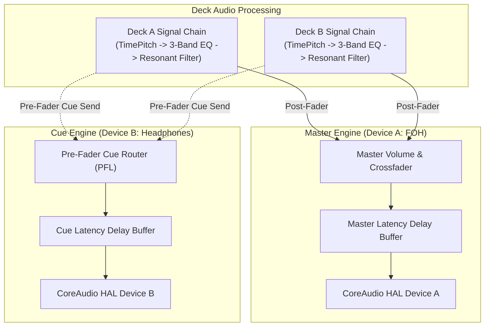

# PulseDeck AI

> **Intelligent Dual-Engine DJ Performance System for macOS**  
> *Engineered natively in Swift 6 and SwiftUI for Apple Silicon (MacBook Pro M1 Pro / 16GB baseline).*

---

## Overview

PulseDeck AI is a professional, high-reliability DJ performance workstation designed specifically for live event, wedding, and mobile DJs on macOS. Built from the ground up to take full advantage of Apple Silicon unified memory architecture and CoreAudio real-time guarantees, PulseDeck AI bridges traditional hands-on dual-deck DJ performance with offline DSP analysis and hybrid artificial intelligence advising.

Unlike consumer playback tools or bloated cross-platform DJ suites, PulseDeck AI adheres to strict real-time audio engineering principles:
* **Dual Independent Output Engines:** Completely segregated CoreAudio output pipelines for Master Front-of-House (FOH) and Cue (Headphones) monitoring without aggregate device clutter.
* **Strict Output-Only Guarantee:** Absolutely zero interaction with audio input hardware (`engine.inputNode`). Preserves high-fidelity Bluetooth A2DP audio codecs and eliminates the risk of feedback loops or OS microphone privacy interrupts.
* **Deterministic Real-Time Safety:** Render callbacks execute free of heap allocations (`malloc`), locks, mutexes, Swift runtime actor hops, or Objective-C ARC retain/release cycles.
* **Protected Human DJ Provenance:** High-precision automated DSP cue analysis that never clobbers manual user adjustments, backed by atomic file persistence.
* **Hybrid Intelligent Advisor:** Offline-first vDSP feature extraction augmented with an optional, rate-limited Google Gemini (`gemini-2.5-flash`) cloud advisor or local Ollama (`localhost:11434`) model.

---

## Hardware & Runtime Requirements

| Parameter | Specification | Notes |
| :--- | :--- | :--- |
| **Hardware Baseline** | MacBook Pro 14" / 16" (M1 Pro, 16GB Unified Memory) | Baseline development and benchmarking platform |
| **Operating System** | macOS Sonoma 14.0 or newer | macOS 14+ required for Swift 6 structured concurrency |
| **Language & Toolchain** | Swift 6.0 (`swift-tools-version: 6.0`) | Strict concurrency checks (`.swiftLanguageMode(.v6)`) |
| **Frameworks** | AVFAudio, CoreAudio HAL, Accelerate (vDSP), SwiftUI | Native Apple frameworks only (zero third-party binary blobs) |
| **Python Companion** | Python 3.10+; standard library for validation, optional `librosa`/`soundfile` for batch analysis | Analyzer dependencies live in `requirements-analysis.txt` |

---

## Current Status: Phase 0 (Operational Foundation)

PulseDeck AI follows a phased, verification-driven development lifecycle. It is critical to distinguish between **operational Phase 0 features shipping today** and **planned features specified for future phases**.

### Operational Today (Phase 0 Deliverables)
* [x] **Complete Swift 6 SPM Project Structure:** Executable target `PulseDeckAI` and library target `PulseDeckCore` with zero compilation warnings under strict Swift 6 concurrency.
* [x] **Native Dark-Themed GUI Shell:** High-contrast macOS DJ interface styled with high-visibility colors (Deck A Teal `#00E5FF`, Deck B Amber `#FF9100`, Master Emerald `#00E676`, Cue Purple `#D500F9`).
* [x] **Hardware & Architecture Status Display:** Real-time visual validation panel verifying hardware baselines, audio thread rules, and cache contracts.
* [x] **Crate & Library Scanner:** Automatic discovery and structural validation of all standard DJ crates in `PulseDeck_Library`, including dynamic track count enumeration, error detection, `.gitkeep` checks, and single in-flight rescan (`Cmd + R`).
* [x] **Local Test Media Preservation:** Integration of real test MP3 files in `00_Test_Tracks_Dev` (media files remain strictly local and git-ignored).
* [x] **Unified Cache Schema v1.0.0:** Production-grade JSON Schema specification (`docs/cache_schema_v1.json`), Swift Codable models (`CacheSchema.swift`), and Python companion classes (`scripts/pulsedeck_cache.py`) with 30 unit tests.
* [x] **Atomic Persistence Service:** Crash-safe temporary-file serialization with synchronous hardware flush (`F_FULLFSYNC` on macOS / `fsync` on Linux) before atomic file replacement guarantees against cache corruption.
* [x] **Codified Architectural Protocols:** Formal Swift protocol specifications for dual audio engines, deck signal processing graphs, latency compensation, and AI advisors.

### Implementation Roadmap
* [x] **Phase 1:** Output-only CoreAudio device handling, dual `AVAudioEngine` graphs, and lock-free SPSC metering; physical routing and Bluetooth timing still require hardware validation.
* [x] **Phase 2:** Offline vDSP waveform/transient/BPM/silence analysis, schema-v1 cache persistence, optional Gemini/Ollama advice, and a dry-run librosa batch companion. Live providers remain unverified; no semantic vocal detection is claimed.
* [ ] **Phase 3:** SwiftUI Canvas multi-band waveform visualizer, interactive colored cue handles (I/O keys), AI trim bypass, and cue scrubbing.
* [ ] **Phase 4:** Automated transition engine (Bass Swap, Filter Echo Wash, Hard Cut), Auto-Pilot state machine, Master talkover ducking (`T`, reducing master music to ~15% linear amplitude over 800ms with mid dip), and RAM-preloaded soundboard (`F1`–`F8`).
* [ ] **Phase 5:** Secondary projector display window (FFT visualizer, Ken Burns background media, Now Playing), external display management, and Master Deck safety locks.

---

## Architectural Highlights

### 1. Dual Independent Output Engines (Output-Only)
PulseDeck AI initializes **two entirely independent `AVAudioEngine` instances**:
1. `masterAudioEngine`: Assigned to the primary Front-of-House CoreAudio device (speakers / PA system).
2. `cueAudioEngine`: Assigned to the secondary CoreAudio device (DJ headphones).



> [!IMPORTANT]
> **Strict Output-Only Policy:** PulseDeck AI **never** accesses `engine.inputNode` on either engine. Accessing `inputNode` triggers macOS microphone permission prompts, degrades Bluetooth A2DP audio connections into low-fidelity bidirectional telephony mode (HFP/SCO @ 8kHz/16kHz mono), and introduces acoustic feedback risks in live DJ venues.

### 2. Real-Time Audio Thread Safety
To eliminate audio dropouts, glitches, and priority inversion:
* **Render Callbacks:** Strictly forbid `malloc`, `free`, class instantiation, Objective-C/Swift ARC retains/releases, file I/O, network sockets, or OS locks (`os_unfair_lock`, `pthread_mutex`).
* **Inter-Thread Communication:** Bounded Single-Producer Single-Consumer (SPSC) lock-free ring buffers and atomic variables transfer metering and playhead data from the audio thread to `@MainActor` UI components.
* **Graph Topology Changes:** Reconfigurations (node connections, device reassignments) are strictly serialized on a private background audio queue.

### 3. Master / Cue Latency Compensation & Bluetooth Constraints
Because physical latency cannot be negative, latency alignment within $[-300\,\text{ms}, +300\,\text{ms}]$ is achieved by delaying the faster audio path:
* **Master Lags Cue ($offset > 0$):** We inject positive delay into the **Cue path**.
* **Cue Lags Master ($offset < 0$):** We inject positive delay into the **Master path**.
* **Bluetooth Audio Limitations:** Wireless Bluetooth audio inherently introduces variable, device-dependent buffer latency and independent hardware clock drift across different headphone chipsets, codecs, and RF environments. While PulseDeck AI provides calibration delay compensation and advisory indicators, physical sample-accurate cueing and scratch beatmatching require wired CoreAudio outputs (USB DAC or 3.5mm jack).

### 4. Cache Schema & Human Provenance Protection
The library cache file (`PulseDeck_Library/.pulsedeck_ai_cache.json`) defines four strictly bounded cue timestamps:
$$\text{0.0} \le \text{startTrimCue} \le \text{vocalEntryCue} \le \text{mixOutCue} \le \text{endTrimCue} \le \text{duration}$$

When a human DJ manually adjusts cues, BPM, or musical key, the track entry records `manualOverrides.isManual = true` along with the list of overridden fields. Re-running automated DSP analysis or re-scanning the library will **never** overwrite manually adjusted fields.

### 5. Hybrid Advisor Safety & Rate Limiting
The AI DJ Advisor evaluates harmonic compatibility (Camelot wheel), energy progression, and transition bar counts:
* **Primary Provider:** Google Gemini API configured for `gemini-2.5-flash`.
* **Rate Limiting:** A rolling window limits all cloud attempts, including retries, to 12 requests in any 60 seconds. Retry count and delay are bounded; `Retry-After` is honored up to 30 seconds.
* **Local Fallback:** Optional local Ollama runs at `http://localhost:11434` by default. If it is unavailable, advisor requests fail with bounded errors; library analysis and playback remain offline.
* **Privacy:** Gemini keys come from `GEMINI_API_KEY` or the configured environment variable and travel only in the `x-goog-api-key` header. Keys never enter URLs, logs, repository, or cache files.
* **Model availability:** `gemini-2.5-flash` remains the default model ID. Google currently limits new-project access; endpoint and model are configurable. See [Google model availability](https://ai.google.dev/gemini-api/docs/models/gemini-2.5-flash).

---

## Project Structure

```
pulsedeckai/
├── Package.swift                             # Swift 6 SPM package manifest (macOS 14+)
├── README.md                                 # Project overview, requirements, architecture
├── docs/
│   ├── TECHNICAL_ARCHITECTURE.md             # Deep architectural specification (Phases 0-5)
│   ├── USER_MANUAL.md                        # Event DJ operating manual, setup, keyboard map
│   └── cache_schema_v1.json                  # JSON Schema (Draft 2020-12) for library cache
├── scripts/
│   ├── analyze_library.py                    # Offline librosa batch estimates; dry run by default
│   └── pulsedeck_cache.py                    # Python companion cache validator & dataclasses
├── Sources/
│   ├── PulseDeckCore/                        # Headless DJ Engine Core Library
│   │   ├── PulseDeckCore.swift               # Constants, versions, standard crate definitions
│   │   ├── Models/
│   │   │   ├── AudioContracts.swift          # Protocols & models for dual engines, EQ, latency
│   │   │   ├── CacheSchema.swift             # CueMarkers, TrackCacheEntry, PulseDeckLibraryCache
│   │   │   ├── LibraryModels.swift           # Crate and scan summary data structures
│   │   │   └── AIAdvisorContracts.swift      # Gemini config, Ollama fallback, advisor protocols
│   │   └── Services/
│   │       ├── CachePersistence.swift       # Atomic JSON read/write & override preservation
│   │       └── LibraryScanner.swift          # Filesystem crate discovery and audio file finder
│   └── PulseDeckAI/                          # SwiftUI Application Executable
│       ├── PulseDeckApp.swift                # App entrypoint, window sizing, MainActor state
│       ├── ViewModels/
│       │   └── AppState.swift                # Published application state and scanning triggers
│       └── UI/
│           ├── Theme.swift                   # High-contrast DJ color palette & styling
│           ├── ContentView.swift             # Root layout container
│           ├── StatusHeaderView.swift        # App branding, specs, and status ribbon
│           ├── LibraryBrowserView.swift      # Crates browser, track counts, track inspection
│           └── ArchitectureStatusView.swift  # Phase 0 architectural contract verification cards
├── Tests/
│   └── PulseDeckCoreTests/                   # Swift Testing / XCTest test suite
│       ├── AudioContractsTests.swift         # Latency math, EQ parameters, filter tests
│       ├── CacheSchemaTests.swift            # Cue ordering, atomic save, override protection tests
│       └── LibraryScannerTests.swift         # Crate discovery and media extension tests
└── PulseDeck_Library/                        # Standard DJ crate hierarchy (Media git-ignored)
    ├── .pulsedeck_ai_cache.json              # Versioned audio analysis cache (Phase 2+)
    ├── 00_Test_Tracks_Dev/                   # Verified test audio files (7 songs, MP3)
    ├── 01_Warmup_Chill_Lounge/               # .gitkeep
    ├── 02_Ceremony_Slow_Romantic/            # .gitkeep
    ├── 03_Oldies_70s_80s_90s/                # .gitkeep
    ├── 04_CZ_SK_Classics/                    # .gitkeep
    ├── 05_MainStage_Dance_120_128BPM/        # .gitkeep
    ├── 06_2000s_Millennium_Hits/             # .gitkeep
    ├── 07_Rock_PopPunk_LateNight/            # .gitkeep
    ├── 08_Soundboard_SFX/                    # .gitkeep
    └── 09_Visual_Backgrounds_Media/          # .gitkeep
```

---

## Building and Running (Phase 0)

### 1. Compile the Swift Package
```bash
# Verify build across library and executable
swift build
```

### 2. Execute the Test Suite
```bash
# Run unit tests validating audio contracts and cache schemas
swift test
```

### 3. Launch the PulseDeck AI Application
```bash
# Run the SwiftUI operational foundation app
swift run PulseDeckAI
```

### 4. Validate the Library Cache with Python Companion
```bash
# Verify the Python companion script against the library cache
python3 scripts/pulsedeck_cache.py PulseDeck_Library/.pulsedeck_ai_cache.json
```

### 5. Run Offline Batch Estimates Safely
Install optional analyzer dependencies, then preview estimates without writing files:
```bash
python3 -m pip install -r requirements-analysis.txt
python3 scripts/analyze_library.py --library-root PulseDeck_Library --cache PulseDeck_Library/.pulsedeck_ai_cache.json --dry-run
```
To write a validated schema v1 copy, pass `--output-cache /tmp/pulsedeck-analysis.json`. The tool reads audio and the input cache only; output must be a separate JSON file outside the library. Unknown tempo keeps BPM/confidence at `0`, beat timestamps empty, and the schema's `1.0` second interval sentinel. It does not infer vocal segments or create beat-based cues.

---

## DJ Library Crate Hierarchy

PulseDeck AI standardizes music library organization into **10 structured crates**. Folder names are strictly preserved to maintain backward compatibility across DJ gig setups:

| Index | Crate Folder Name | Intended Musical Content & Gig Function |
| :---: | :--- | :--- |
| `[00]` | `00_Test_Tracks_Dev` | Development and acoustic benchmarking test tracks (MP3) |
| `[01]` | `01_Warmup_Chill_Lounge` | Guest arrival, cocktail hour, low-energy background vibes |
| `[02]` | `02_Ceremony_Slow_Romantic` | Processionals, first dances, slow romantic ballads |
| `[03]` | `03_Oldies_70s_80s_90s` | Retro classics, disco, funk, 80s pop staples |
| `[04]` | `04_CZ_SK_Classics` | Regional Czech & Slovak wedding and celebration hits |
| `[05]` | `05_MainStage_Dance_120_128BPM` | Peak-time house, EDM, dancefloor anthems (120–128 BPM) |
| `[06]` | `06_2000s_Millennium_Hits` | Y2K pop, 2000s R&B, nostalgic party bangers |
| `[07]` | `07_Rock_PopPunk_LateNight` | High-energy rock, late-night singalongs, party anthems |
| `[08]` | `08_Soundboard_SFX` | RAM-preloaded DJ stingers, horns, drops, and venue chimes |
| `[09]` | `09_Visual_Backgrounds_Media` | High-res video loops and photos for external projector |

> [!NOTE]
> All audio tracks (`.mp3`, `.wav`, `.flac`, `.m4a`, etc.) within `PulseDeck_Library` are strictly excluded from git tracking via `.gitignore`. The folder structure is preserved across clones via `.gitkeep` files.

---

## Phase Roadmap

| Phase | Milestone Name | Scope & Core Deliverables | Status |
| :---: | :--- | :--- | :---: |
| **0** | **Operational Foundation & Documentation** | Swift 6 SPM workspace, SwiftUI dark GUI, library scanner, cache schema v1, architectural protocols, comprehensive docs | **COMPLETE** |
| **1** | **Dual-Engine Audio & Metering** | CoreAudio HAL device routing, dual `AVAudioEngine` startup, 3-band EQ, resonant filter, lock-free SPSC metering | **Implemented; hardware validation pending** |
| **2** | **Offline DSP & Hybrid Advisor** | Accelerate vDSP analysis, beat grid estimation, optional Gemini/Ollama advice, validated cache and batch companion | **Implemented; live-provider validation pending** |
| **3** | **Waveforms, Cues & Interactive Browser** | Multi-band SwiftUI Canvas waveforms, 4 bounded cue handles, keyboard cueing (`I`/`O`), AI trim bypass, cue scrubbing | *Planned* |
| **4** | **Transitions, Auto-Pilot & Soundboard** | Bass Swap, Filter Echo Wash, Hard Cut, Auto-Pilot engine, Talkover ducking (`T`, reducing master to ~15% linear level), RAM soundboard (`F1`–`F8`) | *Planned* |
| **5** | **Projector Screen & Final Polish** | Secondary external presentation window (FFT visualizer, Ken Burns media, Now Playing), master safety locks | *Planned* |

---

## Documentation Links

* [**Technical Architecture Specification**](docs/TECHNICAL_ARCHITECTURE.md): Deep technical breakdown of dual-engine audio graphs, real-time thread safety, latency alignment, cache serialization, and transition contracts.
* [**Event DJ User Manual**](docs/USER_MANUAL.md): Step-by-step operational guide for live performance, hardware setups, keyboard shortcuts, AI Studio API configuration, and troubleshooting.
