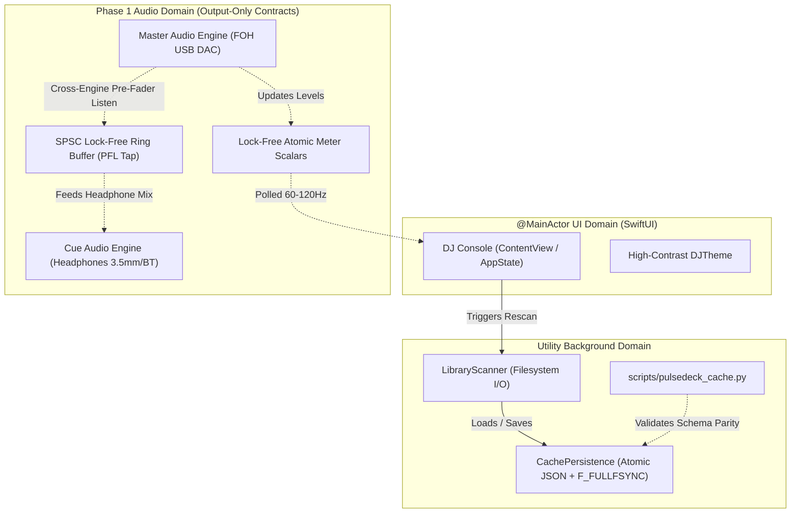

# PulseDeck AI — Phase 0 Operational Foundation & Architecture Contracts
**Comprehensive Phase 0 Summary & Phase 1 Implementation Readiness**

> **Document Purpose:** Authoritative state-of-the-project and operational handover specification. Enables any fresh orchestrator or engineer to resume development without prior chat context.  
> **Repository:** `https://github.com/Ejv1k/PulseDeckAI.git`  
> **Review Pull Request:** [PR #1: feat: implement Phase 0 operational foundation and architecture contracts](https://github.com/Ejv1k/PulseDeckAI/pull/1)  
> **Target Hardware Baseline:** Apple Silicon MacBook Pro 14" / 16" (M1 Pro, 16GB Unified Memory)  
> **Target Software Platform:** macOS 14.0+ (Sonoma) / macOS 15.0+ (Sequoia), Swift 6.0 Concurrency Mode  

---

## 1. Executive Summary & Handover Status

Phase 0 establishes the operational foundation, architecture contracts, versioned cache schema, and SwiftUI high-contrast application shell for PulseDeck AI. All Phase 0 gates, code review findings, and verification criteria have been completed.

### 1.1 Gate & Status Summary
* **Phase 0 Status:** **COMPLETE & FROZEN**. Awaiting orchestrator / reviewer final sign-off.
* **Phase 1 Status:** **NOT STARTED** (Strict scope boundary: Phase 1 implementation begins only after Phase 0 review approval).
* **PR #1 Status:** Open against `origin/main` (base: clean empty commit `5aa14b4`, head: `phase-0-foundation`).
* **Code Review Findings:** **10/10 inline findings resolved** via `ao pr resolve-comments`.
* **Test Suite Status:** **21/21 Swift unit tests passing**, **30/30 Python unit tests passing**, cache validation **SUCCESS**.
* **Release Executable:** Compiled at `.build/release/PulseDeckAI` (Mach-O 64-bit arm64, 925 KB).
* **Media Hygiene:** All 7 development audio files preserved on disk in `PulseDeck_Library/00_Test_Tracks_Dev/`, untracked from Git, and protected by strict `.gitignore`.

---

## 2. Git Architecture & Worktree Source-of-Truth

### 2.1 Critical Worktree Rules
* **Active Working Tree (Source-of-Truth):**  
  `/Users/tomaselagin/.ao/data/worktrees/pulsedeckai/pulsedeckai-2`  
  Branch: `phase-0-foundation` tracking `origin/phase-0-foundation`.
* **Legacy Checkout Warning:**  
  Do **NOT** use or commit to the desktop clone at `/Users/tomaselagin/Desktop/PulseDeckAI`. Its initial commit `fe2a499` tracked 25 MB of binary MP3 files. Never push `fe2a499` ancestry to remote.
* **Remote Baseline:**  
  `origin/main` was initialized with clean empty root commit `5aa14b44c8cfa65276342abd9408fbef5fbdf7ea` (tree `4b825dc...`, 0 files, zero binary media ancestry).
* **Commit Lineage (`phase-0-foundation`):**
  1. `5aa14b4` — *Base:* Empty root commit on `origin/main`.
  2. `b13e361` — `feat(foundation): initialize Phase 0 Swift package and architectural foundation`
  3. `dcf8057` — `test(scanner): use hermetic temporary fixture and remove gitignored media assertions`
  4. `61b6234` — `fix(review): clamp preserved cues, preserve selected crate across rescans, handle scanner errors, and harden cache parity`
  5. `18c05f2` — `feat(review): integrate Python test suite and implement bounded review improvements`
  6. `5dd90ad` — `fix(cache): validate schema version and track bounds on cache load`
  7. `34b9454` — `fix(review): fail re-analysis merge on invalid duration, clamp cues, throw on flush failure, and clean up temp cache`

### 2.2 Review Thread Resolution Summary
All 10 review findings from native Grok code reviews have been implemented, tested, and resolved:
* `PRRT_kwDOVJOZu86sXbOf` — Cue markers clamped to track duration upon re-analysis.
* `PRRT_kwDOVJOZu86sXbOt` — Python dataclass `copy.deepcopy` immutability in `pulsedeck_cache.py`.
* `PRRT_kwDOVJOZu86sXbOx` — Python schema 1.0.0 enforcement and cue ordering validation.
* `PRRT_kwDOVJOZu86sXbO2` — Selected crate selection preserved across library rescans in `AppState.swift`.
* `PRRT_kwDOVJOZu86sXbO9` — Distinguish directory read errors from empty crate folders in `LibraryScanner.swift`.
* `PRRT_kwDOVJOZu86sXbPE` — Hermetic scanner test fixtures replacing gitignored media dependencies in `LibraryScannerTests.swift`.
* `PRRT_kwDOVJOZu86sfox0` — `TrackCacheEntry.mergingPreservingOverrides` rejects merge on invalid/negative duration, clamps automated cues to `[0, duration]`, and rejects non-finite values in `CueMarkers.isValid(forDuration:)`.
* `PRRT_kwDOVJOZu86sfoyB` — Strict schema 1.0.0 validation, positive finite duration, confidence in `[0, 1]`, and cue ordering in `CachePersistence.load(from:)`.
* `PRRT_kwDOVJOZu86sfoyG` — Corrupt cache files set `scanError` in `LibraryScanner.swift` instead of reporting library verified.
* `PRRT_kwDOVJOZu86sfoyP` — POSIX file flush (`fcntl(fd, F_FULLFSYNC)`) and directory sync in `CachePersistence.saveAtomic`, with `defer` temporary file cleanup on any failure path.

---

## 3. Implemented Components & Verified Functionality

### 3.1 Swift 6 Package Architecture (`Package.swift`)
* Configured for Swift 6 language mode on macOS 14.0+.
* **`PulseDeckCore` (Library Target):**
  * `Models/CacheSchema.swift`: Codable, Equatable, Hashable, Sendable cache models (`PulseDeckLibraryCache`, `TrackCacheEntry`, `CueMarkers`, `BeatGrid`, `WaveformMetadata`, etc.).
  * `Models/AudioEngineContract.swift`: CoreAudio dual-engine protocols (`MasterAudioEngineProtocol`, `CueAudioEngineProtocol`), device descriptors, real-time thread safety constraints, and latency alignment definitions.
  * `Services/LibraryScanner.swift`: Concurrent filesystem scanner enumerating 10 crate folders, parsing tracks, and loading cache files.
  * `Services/CachePersistence.swift`: Durable atomic JSON persistence with `F_FULLFSYNC` flush, atomic rename, and strict schema validation.
* **`PulseDeckAI` (Executable Target):**
  * `PulseDeckAIApp.swift`: SwiftUI application entry point.
  * `AppState.swift`: `@MainActor` application state managing library scanning, crate selection persistence, background serialization, and debounced rescanning.
  * `Views/ContentView.swift`: High-contrast dark DJ console interface featuring 10-crate sidebar, track table, audio routing indicator, and live system status ribbon.
  * `Views/DJTheme.swift`: Standardized DJ color palette (Jet Black `#0A0B0F`, Card `#14171F`, Deck A Cyan `#00E5FF`, Deck B Orange `#FF6D00`, Master Green `#00E676`, Cue Amber `#FFD600`).
* **`PulseDeckCoreTests` (Test Target):**
  * 21 automated unit tests verifying schema encoding/decoding, cue ordering validation, override preservation, invalid duration fail-safes, atomic persistence durability, cleanup on failure, hermetic crate scanning, and scanner error propagation.

### 3.2 Python Companion Cache Validator (`scripts/pulsedeck_cache.py`)
* Mirror implementation of the cache schema in Python 3.10+.
* Validates cache files against `docs/cache_schema_v1.json`.
* Enforces deep copy immutability, schema version 1.0.0 checks, confidence ranges `[0.0, 1.0]`, positive finite durations, cue marker ordering, and manual override preservation.
* Backed by 30 unit tests in `scripts/tests/test_pulsedeck_cache.py`.

### 3.3 Media Preservation & Git Hygiene
* Local test tracks located at `PulseDeck_Library/00_Test_Tracks_Dev/`:
  1. `ABBA - Gimme! Gimme! Gimme! (A Man After Midnight).mp3` (3.3 MB)
  2. `AC⧸DC - Highway to Hell (Official Video).mp3` (3.4 MB)
  3. `Daft Punk - One More Time (Official Video).mp3` (5.2 MB)
  4. `Dua Lipa - Don't Start Now (Official Music Video).mp3` (2.9 MB)
  5. `Ed Sheeran - Perfect (Official Music Video).mp3` (4.2 MB)
  6. `KABÁT - Pohoda.mp3` (3.5 MB)
  7. `Queen - Don't Stop Me Now (Official Video Remastered 4K).mp3` (3.2 MB)
* All 7 files are physically present on disk, gitignored (`*.mp3`), and excluded from Git commits.
* Strict `.gitignore` protects audio media, `.env` files, credentials, and build directories while tracking `.gitkeep` and `.pulsedeck_ai_cache.json`.

---

## 4. Architectural Invariants & Core Design Rules



### 4.1 Strict Output-Only Audio Rule
* **Microphone Input Forbidden:** `AVAudioEngine.inputNode` must **NEVER** be accessed or initialized. Accessing `inputNode` triggers macOS microphone permission prompts (TCC) and downgrades Bluetooth headphones from high-fidelity stereo A2DP to 16kHz mono hands-free profile (HFP/SCO).
* Both Master and Cue engines operate exclusively as output-only graphs.

### 4.2 Real-Time Audio Thread Safety
In CoreAudio render callbacks (`AURenderCallback`, `AVAudioSourceNode` render blocks):
1. **NO heap allocations:** `malloc`, `free`, Swift class instantiation, array resizing are strictly banned.
2. **NO locks or synchronization:** `os_unfair_lock`, `pthread_mutex`, Swift actor hops (`await`) are banned.
3. **NO Objective-C runtime calls or Swift ARC:** ARC retain/release operations cause unbounded priority inversion.
4. **NO file or socket I/O:** Disk reads and network calls must be executed asynchronously on background queues.
5. **IPC Mechanism:** Communication between audio threads and UI relies exclusively on single-producer single-consumer (SPSC) lock-free ring buffers and atomic scalar loads/stores.

### 4.3 Cache Schema & Re-Analysis Invariants
* **Schema Version:** Strictly `"1.0.0"`. Documents with other versions are rejected.
* **Cue Marker Ordering:**
  $$0.0 \le \text{startTrimCue} \le \text{vocalEntryCue} \le \text{mixOutCue} \le \text{endTrimCue} \le \text{duration}$$
* **Re-analysis Durability:**
  * If new duration is non-finite (NaN, $\pm\infty$) or negative, re-analysis fails safely by returning existing entry unmodified.
  * If manual overrides are active (`manualOverrides.isManual == true`), manual cue markers, BPM, and musical key are preserved.
  * If only BPM or key is manually overridden, automated cue markers from new analysis are clamped to `[0, duration]`.

---

## 5. Phase 1 Audio Implementation Readiness & Architectural Research

> [!NOTE]
> The following research and specifications are preserved from Phase 0 architectural analysis to guide Phase 1 audio engine implementation. Phase 0 implemented typed protocol contracts only; no physical audio device validation has been conducted.

### 5.1 CoreAudio Device Enumeration & Property Listeners
* **System Object:** `AudioObjectID(kAudioObjectSystemObject)` (`1`).
* **Property Selectors:**
  * Device enumeration: `kAudioHardwarePropertyDevices` (`'dev#'`).
  * Default output device: `kAudioHardwarePropertyDefaultOutputDevice` (`'dOut'`).
  * Device name: `kAudioObjectPropertyName` (`'lnam'`).
  * Device UID: `kAudioDevicePropertyDeviceUID` (`'uid '`).
  * Stream configuration: `kAudioDevicePropertyStreamConfiguration` (`'slay'`) with `kAudioObjectPropertyScopeOutput`.
* **Scope & Element Conventions:**
  * Scope: `kAudioObjectPropertyScopeGlobal` (`'glob'`).
  * Element: `kAudioObjectPropertyElementMain` (`0`). *Do not use deprecated `kAudioObjectPropertyElementMaster`.*
* **Output Channel Requirement:**
  * Calculate output channels: $\sum \text{mBuffers}[i].\text{mNumberChannels}$.
  * Only include devices with $\ge 2$ output channels. Devices with 0 output channels (e.g. microphones, aggregate input taps) must be omitted.
* **Hotplug Listener Lifecycle:**
  * Register using `AudioObjectAddPropertyListenerBlock` with a dedicated serial `DispatchQueue(label: "com.pulsedeck.coreaudio.listener")`.
  * Deregister in `deinit` using `AudioObjectRemovePropertyListenerBlock` passing identical block reference and dispatch queue.

### 5.2 AUHAL Output Unit Binding
To route an `AVAudioEngine` instance to a specific physical output without aggregate devices:
```swift
func routeEngineOutput(_ engine: AVAudioEngine, to deviceID: AudioDeviceID) throws {
    guard let audioUnit = engine.outputNode.audioUnit else {
        throw AudioRoutingError.audioUnitUnavailable
    }
    
    // Engine must be stopped before retargeting AUHAL device property
    var targetID = deviceID
    let propertySize = UInt32(MemoryLayout<AudioDeviceID>.size)
    let status = AudioUnitSetProperty(
        audioUnit,
        kAudioOutputUnitProperty_CurrentDevice, // 2000
        kAudioUnitScope_Global,                 // 0
        0,                                      // Element 0 (Main)
        &targetID,
        propertySize
    )
    guard status == noErr else {
        throw AudioRoutingError.deviceBindingFailed(status: status)
    }
}
```
* **Engine Lifecycle Rule:** If `engine.isRunning` is true, call `engine.stop()`, set `kAudioOutputUnitProperty_CurrentDevice`, call `engine.prepare()`, then call `try engine.start()`. Retargeting while rendering risks driver assertion crashes.

### 5.3 Dual-Engine Master & Cue Architecture

```
┌────────────────────────────────────────────────────────────────────────┐
│ MASTER AUDIO ENGINE (Device A: FOH Main PA)                            │
│                                                                        │
│ Deck A PlayerNode ──> TimePitch ──> 3-Band EQ ──> Filter ──┬──> Fader ┐│
│                                                            │ (Tap A)  ││
│ Deck B PlayerNode ──> TimePitch ──> 3-Band EQ ──> Filter ──┼──> Fader ┼┤
│                                                            │ (Tap B)  ││
│                                              MainMixerNode <──────────┘│
│                                                    │                   │
│                                            Delay Line (0..300ms)       │
│                                                    │                   │
│                                            OutputNode (HAL AU: Dev A)  │
└────────────────────────────────────────────────────┼───────────────────┘
                                                     │ SPSC Ring Buffer
                                                     │ (PFL Monitoring)
┌────────────────────────────────────────────────────▼───────────────────┐
│ CUE AUDIO ENGINE (Device B: DJ Headphones)                             │
│                                                                        │
│ [Mode 1: Independent Preview & Scrubbing]                              │
│ Cue Preview PlayerNode ──> TimePitch ──> Cue EQ ───┐                  │
│ (Independent File, Playhead, Seek, Loop, Play/Pause)│                  │
│                                                    ▼                   │
│ [Mode 2: Pre-Fader Listen (PFL) Monitoring]   CueMixerNode             │
│ SourceNode A (RingBuffer Tap A) ──[Cue A Sw]───────┤                   │
│ SourceNode B (RingBuffer Tap B) ──[Cue B Sw]───────┤                   │
│                                                    ▼                   │
│                                            Delay Line (0..300ms)       │
│                                                    │                   │
│                                            OutputNode (HAL AU: Dev B)  │
└────────────────────────────────────────────────────────────────────────┘
```

#### Dual Headphone Listening Modes:
1. **Independent Cue Preview & Scrubbing:** Dedicated `cuePreviewPlayer` (`AVAudioPlayerNode`) in `cueAudioEngine`. Allows browsing and scrubbing any library track or deck track in headphones with independent playhead, pitch, and loops. Scrubbing has zero effect on Master FOH playback.
2. **Pre-Fader Listen (PFL) Monitoring:** Non-allocating tap on Master signal chain writes into an SPSC lock-free ring buffer. An `AVAudioSourceNode` in `cueAudioEngine` dequeues frames into `cueMixerNode` when headphone cue switches are engaged.

#### Clock Drift & Hardware Synchronization:
* Master (e.g. USB DAC) and Cue (e.g. Built-in Jack / Bluetooth) operate on independent physical crystal oscillators, typically drifting by $1\text{--}10\,\text{samples/second}$ ($\sim 20\text{--}200\,\text{ppm}$).
* **Independent Preview:** Unaffected by drift (clocked directly by Cue engine output).
* **PFL Monitoring Bridge:** SPSC ring buffer maintains a nominal watermark of $\sim 50\,\text{ms}$ (2,400 samples at 48kHz). If buffer fill level drifts beyond $\pm 20\,\text{ms}$, the bridge drops or duplicates 1 stereo sub-frame (2 samples) at zero-crossings, avoiding audible pops.
* **Synchronized Deck Starts:** Anchored to Mach absolute time using `AVAudioPlayerNode.play(at: AVAudioTime)` with a $50\text{--}100\,\text{ms}$ scheduling lead.

### 5.4 Graph Topology & Sample Rate Conversion
* **Connection Constraint:** `AVAudioEngine` node connections require identical sample rates. Directly connecting a 48,000 Hz node to an `outputNode` configured for 44,100 Hz throws a format mismatch error.
* **Intermediate Mixer Solution:**
  1. Standardize all internal graph nodes (`AVAudioPlayerNode`, `AVAudioUnitTimePitch`, `AVAudioUnitEQ`) to 32-bit Float stereo at 48,000 Hz:
     ```swift
     let canonicalFormat = AVAudioFormat(standardFormatWithSampleRate: 48000, channels: 2)!
     ```
  2. Route all player chains into `engine.mainMixerNode` using `canonicalFormat`.
  3. `AVAudioMixerNode` internally wraps Apple's `AudioConverter` unit, automatically resampling and down/up-mixing to match whatever hardware sample rate `outputNode` requires.

### 5.5 Swift 6 Real-Time Primitives on macOS 14
* **macOS Version Constraint:** `Synchronization.Atomic<T>` requires macOS 15.0+; it is unavailable on macOS 14.
* **`swift-atomics` Constraint:** `ManagedAtomic<T>` does not support `Float` directly due to IEEE 754 multi-representation rules.
* **Production Solutions:**
  * Option A: `ManagedAtomic<UInt32>` storing `Float.bitPattern`:
    ```swift
    import Atomics

    final class AtomicFloat: @unchecked Sendable {
        private let storage: ManagedAtomic<UInt32>
        init(_ value: Float = 0.0) { storage = ManagedAtomic(value.bitPattern) }
        @inline(__always) func store(_ value: Float, ordering: AtomicStoreOrdering = .relaxed) {
            storage.store(value.bitPattern, ordering: ordering)
        }
        @inline(__always) func load(ordering: AtomicLoadOrdering = .relaxed) -> Float {
            Float(bitPattern: storage.load(ordering: ordering))
        }
    }
    ```
  * Option B: C11 `<stdatomic.h>` wrapper struct in `PulseDeckCore`. Apple Silicon ARM64 executes scalar 32-bit float loads/stores via native single-instruction `LDR`/`STR`.
* **Accelerate Metering:** Render taps compute peak (`vDSP_maxv`) and RMS (`vDSP_rmsqv`) in-place, store into atomic float, and `@MainActor` UI polls at 60–120Hz.

### 5.6 Latency Alignment Model
* Range: $[-300\,\text{ms}, +300\,\text{ms}]$.
* Negative physical latency is impossible. To align outputs:
  * When Master lags Cue ($\Delta t > 0$): inject delay into **Cue** output path.
  * When Cue lags Master ($\Delta t < 0$, e.g. wireless Bluetooth): inject delay into **Master** output path.
  * Ring buffer delay lines sized for $\text{SampleRate} \times 0.300\,\text{s}$ ($\sim 14,400$ frames at 48kHz).

---

## 6. Operational Playbook: Build, Test & Resume Commands

For any subsequent agent, orchestrator, or engineer resuming work:

### 6.1 Environment Prerequisites
* Apple Silicon Mac (M1 Pro / 16GB baseline or higher).
* macOS 14.0+ (Sonoma) or macOS 15.0+ (Sequoia).
* Xcode Command Line Tools with Swift 6.0+ (Swift 6.4 verified).
* Python 3.10+ with standard library (no external pip dependencies required for Phase 0).

### 6.2 Key Verification Commands
```bash
# 1. Navigate to active worktree
cd /Users/tomaselagin/.ao/data/worktrees/pulsedeckai/pulsedeckai-2

# 2. Verify git status (must be on phase-0-foundation, working tree clean)
git status

# 3. Compile debug build
swift build

# 4. Compile release build
swift build -c release

# 5. Execute all Swift unit tests (21 tests)
swift test

# 6. Execute all Python companion unit tests (30 tests)
python3 -m unittest discover -s scripts/tests

# 7. Execute companion cache file validator
python3 scripts/pulsedeck_cache.py

# 8. Check AO review status
ao review ls
```

### 6.3 PR #1 Merge & Phase 1 Transition Protocol
1. **Do NOT merge PR #1 prematurely.**
2. Await native Grok 4.7 review verdict confirmation on the latest head commit.
3. Verify that the orchestrator greenlights transition to Phase 1.
4. Merge PR #1 into `main` via standard PR merge workflow.
5. Begin Phase 1 audio engine implementation following the architectural contracts in `Sources/PulseDeckCore/Models/AudioEngineContract.swift` and the design specifications detailed in Section 5 of this document.
