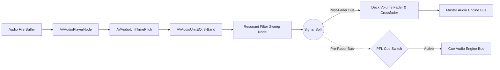
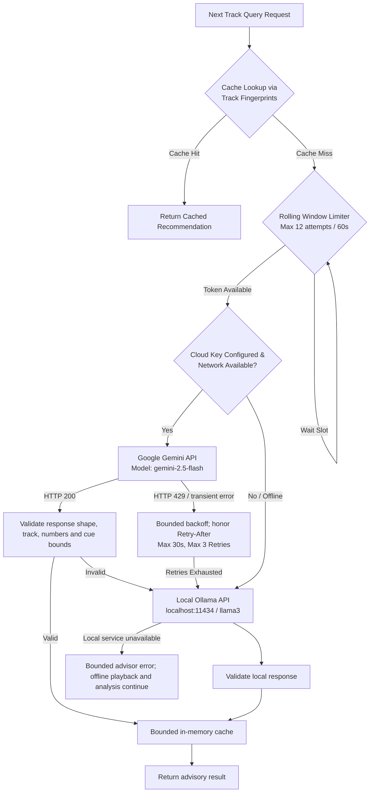
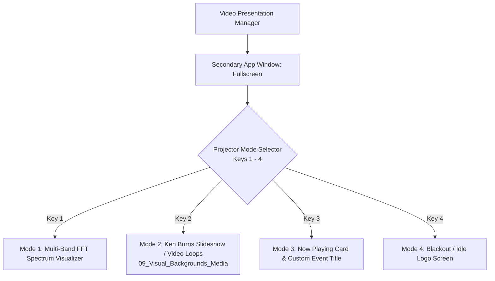

# PulseDeck AI — Technical Architecture Specification

> **Document Status:** Authoritative Architectural Specification (Phase 0 Baseline)  
> **Target Hardware Baseline:** Apple Silicon MacBook Pro 14" / 16" (M1 Pro, 16GB Unified Memory)  
> **Target Software Platform:** macOS Sonoma (14.0+) / macOS Sequoia (15.0+), Swift 6.0 Concurrency Mode  
> **Document Scope:** Full architectural contracts, hardware interfaces, audio pipelines, memory models, transition mathematics, and phase roadmaps.

---

## 1. System Overview & Core Design Philosophy

PulseDeck AI is a professional, high-reliability DJ performance system engineered specifically for Apple Silicon and macOS. Unlike traditional consumer DJ applications that rely on aggregate virtual audio devices or monolithic audio engines with high latency overhead, PulseDeck AI introduces an **asymmetric dual-engine, output-only CoreAudio architecture**.

```mermaid
graph TD
    subgraph HostSystem["macOS 14+ / Apple Silicon M1 Pro / 16GB Unified Memory"]
        subgraph UIConcurrency["@MainActor UI Layer (SwiftUI)"]
            MainWindow["Main DJ Performance Window"]
            Browser["10-Crate Library Browser"]
            StatusRibbon["Hardware & Status Monitors"]
            ProjectorView["External Projector Window (Phase 5)"]
        end

        subgraph BackgroundDomain["Serialized Background Task Queue"]
            Scanner["LibraryScanner (Filesystem I/O)"]
            CacheService["CachePersistence (Atomic JSON I/O)"]
            DSPTask["vDSP Offline Analysis (Phase 2)"]
            AIAdvisor["AIAdvisorService (Gemini / Ollama)"]
        end

        subgraph InterThread["Bounded Transfer Boundaries"]
            SPSC_Ring["Lock-Free SPSC Ring Buffers (Metering / Playhead)"]
            Atomics["Atomic Control Flags (std::atomic)"]
        end

        subgraph RealTimeAudio["CoreAudio Real-Time Render Pipeline"]
            subgraph MasterEngine["masterAudioEngine (Device A: FOH)"]
                DeckA_Out["Deck A Output Bus"]
                DeckB_Out["Deck B Output Bus"]
                MasterMixer["Master Summer & Crossfader"]
                MasterDelay["Latency Delay Line (0..300ms)"]
                HAL_Master["CoreAudio Output HAL Node"]
                DeckA_Out --> MasterMixer
                DeckB_Out --> MasterMixer
                MasterMixer --> MasterDelay --> HAL_Master
            end

            subgraph CueEngine["cueAudioEngine (Device B: Headphones)"]
                DeckA_Cue["Deck A Pre-Fader Send (PFL)"]
                DeckB_Cue["Deck B Pre-Fader Send (PFL)"]
                CueMixer["Cue Bus Router"]
                CueDelay["Latency Delay Line (0..300ms)"]
                HAL_Cue["CoreAudio Output HAL Node"]
                DeckA_Cue --> CueMixer
                DeckB_Cue --> CueMixer
                CueMixer --> CueDelay --> HAL_Cue
            end
        end

        UIConcurrency -.->|Dispatches Mutations| BackgroundDomain
        BackgroundDomain -->|Atomic State Updates| UIConcurrency
        RealTimeAudio -->|Lock-Free Enqueue| SPSC_Ring
        SPSC_Ring -->|Bounded Dequeue| UIConcurrency
        UIConcurrency -->|Atomic Control Writes| Atomics
        Atomics -->|Real-Time Reads| RealTimeAudio
    end
```



### Core Design Tenets
1. **Zero Dropouts in Performance:** The real-time render thread is treated as an inviolable environment. Zero allocations, zero locking primitives, and zero runtime overhead.
2. **Output-Only Hardware Isolation:** Audio inputs are structurally excluded. Calling `engine.inputNode` is strictly forbidden across the codebase.
3. **Deterministic Cache & DJ Provenance:** Automated acoustic analysis provides intelligent baseline suggestions, but a human DJ's manual adjustments are sacred and immutable.
4. **Resilient Hybrid Intelligence:** The system functions 100% offline at all times. Cloud AI advising is an optional advisory overlay wrapped with strict rate limits, retries, and local fallback models.
5. **Phase-Gated Implementation:** Every capability belongs to a defined phase. Phase 0 delivers an operational dark-themed shell with verified contracts, ready for Phase 1 audio implementation.

---

## 2. Hardware Baseline & Runtime Constraints

### 2.1 Hardware Specification
The hardware baseline for PulseDeck AI is defined as:
* **System:** Apple MacBook Pro (14-inch or 16-inch).
* **SoC:** Apple M1 Pro (8 performance cores, 2 efficiency cores, 16-core Neural Engine).
* **Memory:** 16GB Unified Memory (~200 GB/s system memory bandwidth).
* **Storage:** Apple NVMe SSD (minimum 512GB).
* **Display Output:** Built-in Liquid Retina XDR display + HDMI 2.0 / USB-C DisplayPort for secondary video projector output.

### 2.2 Concurrency & Swift 6 Safety
PulseDeck AI is compiled with the Swift 6 compiler with strict concurrency checking enabled (`.swiftLanguageMode(.v6)`):
* **Data Race Safety:** All shared structures conform to `Sendable`. Mutable state is isolated to `@MainActor` or encapsulated within thread-safe actors and lock-free structures.
* **Separation of Concerns:**
  * `@MainActor`: Owns SwiftUI View hierarchy, user interaction handling, and reactive ViewModels (`AppState`).
  * `AudioQueue`: A dedicated private serial `DispatchQueue` (`com.pulsedeck.audio.graph`) responsible for audio node graph assembly, reconfiguration, and device switching.
  * `UtilityQueue`: Detached background tasks for filesystem traversal, checksumming, and offline DSP analysis.
  * `CoreAudio Real-Time Thread`: OS-scheduled high-priority render callback thread.

---

## 3. Dual-Engine Output-Only Audio Architecture

### 3.1 Two Independent `AVAudioEngine` Instances
Rather than routing multiple decks into a single multi-channel aggregate audio device, PulseDeck AI instantiates **two distinct, decoupled `AVAudioEngine` instances**:

1. **`masterAudioEngine` (FOH / Master Output):**
   * Configured to output to physical CoreAudio Device A (e.g. external USB audio interface connected to the club sound system or PA mixer).
   * Renders the master mix comprising Deck A, Deck B, Soundboard SFX, and Master Talkover ducking.
2. **`cueAudioEngine` (PFL / Headphone Cue):**
   * Configured to output to physical CoreAudio Device B (e.g. MacBook Pro built-in 3.5mm headphone jack or low-latency monitoring headphones).
   * Renders pre-fader listen (PFL) channels for Deck A, Deck B, and audition previews.

### 3.2 The Strict Output-Only Policy (No `inputNode`)

> [!CAUTION]
> Calling or accessing `engine.inputNode` on either `AVAudioEngine` instance is strictly forbidden.

**Technical Rationale:**
1. **Bluetooth A2DP Codec Preservation:**
   When an application requests input from a Bluetooth audio device (or the system default input when Bluetooth headphones are active), macOS automatically transitions the Bluetooth device profile from **A2DP** (Advanced Audio Distribution Profile, high-fidelity stereo streaming using AAC or SBC at 44.1/48 kHz) to **HFP/HSP** (Hands-Free Profile, bidirectional telephony mode at 8 kHz or 16 kHz mono). This results in catastrophic degradation of audio quality, heavy quantization noise, and unusable monitoring latency.
2. **Microphone Privacy Interruptions:**
   Accessing `inputNode` triggers the macOS system microphone privacy prompt (`TCC`). If declined or delayed, the engine fails to start or outputs silence. In live venue environments, an accidental modal prompt can halt a DJ set.
3. **Acoustic Feedback Elimination:**
   DJ booths operate at sound pressure levels exceeding 95–105 dB SPL. Opening an accidental microphone input channel risks immediate, deafening feedback loops through the PA system.

### 3.3 CoreAudio HAL Device Enumeration & Hotplug Resilience
Device management interfaces directly with the CoreAudio Hardware Abstraction Layer (HAL):
* **Enumeration:** Queries `kAudioHardwarePropertyDevices` using `AudioObjectGetPropertyData` to enumerate physical output endpoints (`AudioDeviceDescriptor`).
* **Classification:** Inspects transport type (`kAudioDevicePropertyTransportType`) to identify USB, Thunderbolt, Built-In (3.5mm), and Bluetooth devices (`kAudioDeviceTransportTypeBluetooth`).
* **Hotplug Listener:** Registers HAL property listeners (`kAudioHardwarePropertyDefaultOutputDevice`, `kAudioHardwarePropertyDevices`) to detect cable disconnections or device additions.
* **Fault Recovery:** If an active output device is unplugged during a live set:
  1. The affected engine's render graph is paused with `AVAudioEngine.pause()` so scheduled playback is kept. `stop()` is not used, because it resets the graph.
  2. The same device UID remains selected when CoreAudio assigns it a new numeric ID. Fallback runs only after a successful topology query proves that UID absent. Order is the preferred UID, then the system default output, then the first enumerated output with channels.
  3. A failed enumerate, default-device, or UID lookup reports that error and leaves the engine running state and the bound UID/ID unchanged. It is not an empty device list. A thrown UID, output channel-count, or sample-rate `osStatus` during enumeration fails that pass. An empty UID, a channel count of 0, `invalidSampleRate`, and a rate that was read and is non-finite or not positive are omitted. A thrown output-channel count for the default device fails that pass. A registration that kept a numeric ID and no UID resolves that ID before fallback.
  4. Bind and start retries are capped at three attempts per candidate UID and topology generation. The cap resets when that set changes or recovery succeeds.
  5. An alert ribbon notifies the DJ on the `@MainActor` UI.
* **Engine mutation ownership:** `start`, `pause`, `stop`, and output-device bind for a registered engine run only on `com.pulsedeck.audio.control`. Other callers must not mutate that engine concurrently. Listener callbacks are delivered off that queue.

---

## 4. Deck Signal Processing Chains (Deck A & Deck B)

Each deck implements an identical, independent audio processing pipeline:



### 4.1 Transport & TimePitch (`AVAudioUnitTimePitch`)
* **Playback Rate (`rate`):** Linear speed multiplier ranging from `0.92` to `1.08` ($\pm 8.0\%$ tempo range).
* **Pitch Shift (`pitchCents`):** Chromatic transposition ranging from `-2400` to `+2400` cents ($\pm 2$ octaves).
* **Key Lock (`keyLockEnabled = true`):** When active, pitch is held constant at `0.0` cents while `rate` adjusts to beatmatch the incoming track, preventing chipmunk or slowed vocal artifacts.

### 4.2 3-Band Equalizer (`AVAudioUnitEQ`)
Standard DJ isolator EQ modeled with professional crossover frequencies and steep shelf curves:
* **Low Shelf Filter:**
  * Cutoff Frequency: $250\,\text{Hz}$
  * Gain Range: $-24.0\,\text{dB}$ to $+6.0\,\text{dB}$ ($0.0\,\text{dB}$ unity)
  * Use: Bass kick and sub isolation, fundamental frequency cuts during transitions.
* **Mid Parametric Peaking Filter:**
  * Center Frequency: $1200\,\text{Hz}$
  * Bandwidth / $Q$: $1.0$
  * Gain Range: $-24.0\,\text{dB}$ to $+6.0\,\text{dB}$ ($0.0\,\text{dB}$ unity)
  * Use: Vocal clarity, snare, and lead instrument balancing.
* **High Shelf Filter:**
  * Cutoff Frequency: $3500\,\text{Hz}$
  * Gain Range: $-24.0\,\text{dB}$ to $+6.0\,\text{dB}$ ($0.0\,\text{dB}$ unity)
  * Use: Hi-hat, cymbals, air, and high-frequency sparkle.

### 4.3 Resonant Bipolar Sweep Filter
A dual-pole resonant filter controllable via a single bipolar parameter:
* **Parameter Range:** $\text{sweep} \in [-1.0, +1.0]$:
  * $\text{sweep} = 0.0$: Filter bypassed (flat frequency response).
  * $\text{sweep} < 0.0$: Low-Pass Filter (LPF). Cutoff sweeps downward from $20\,\text{kHz}$ to $100\,\text{Hz}$.
  * $\text{sweep} > 0.0$: High-Pass Filter (HPF). Cutoff sweeps upward from $20\,\text{Hz}$ to $10\,\text{kHz}$.
* **Resonance ($Q$):** Configurable from $0.5$ (gentle) to $5.0$ (resonant squeal), default $1.0$.

---

## 5. Real-Time Audio Thread Safety Specification

### 5.1 Strict Render Callback Prohibitions
The CoreAudio real-time render thread operates under strict hard-deadline scheduling. A failure to return a buffer in time causes an immediate buffer underrun (audible click or pop). The following operations are **strictly prohibited** inside render blocks:

| Prohibited Operation | Failure Mechanism & Consequence |
| :--- | :--- |
| **`malloc` / `free` / `realloc`** | Heap locks and system allocator contention cause non-deterministic execution times. |
| **Class Instantiation & Swift ARC** | Retain/release operations execute atomics that can trigger heap deallocation on the audio thread. |
| **Locks, Mutexes, Semaphores** | `pthread_mutex`, `os_unfair_lock`, or `DispatchSemaphore` cause **Priority Inversion** when a lower-priority thread holds the lock. |
| **File & Network I/O** | Disk seek or socket polling operations stall the thread for multiple milliseconds. |
| **Direct UI or Actor Messaging** | Hopping to `@MainActor` or posting Combine notifications blocks real-time execution. |

### 5.2 Lock-Free Inter-Thread Communication
1. **Meter SPSC Ring Buffers:**
   Master and Cue output taps each write to a separate, fixed 32-record C11 SPSC ring. Each record carries RMS, peak, a 512-bin spectrum, sample rate, host time, frame count, and FFT size. Release/acquire cursors publish complete records; when full, the producer drops the newest record and increments a dropped-record counter. Startup refuses the ring if its cursor atomics are not lock-free.
2. **Atomic Scalar Transfers:**
   Volume coefficients, crossfader positions, filter cutoff frequencies, and transport commands are read atomically using Swift `Atomic` / C++ `std::atomic` values without locking.
3. **Meter Dequeuing:**
   The UI drains each role on the control queue at 30 Hz and receives an immutable `Sendable` snapshot. Swift spectrum-array allocation happens after dequeue, off the render thread.

### 5.3 Output Meter Format, DSP, and Lifetime
Meter taps attach only to the master and cue output submixers. They never read `inputNode`, start an engine, or start track playback. Startup validates Float32, mono/stereo output at 8–192 kHz, then allocates each ring, vDSP FFT setup, window, and scratch buffer before installing taps. The 1024-point FFT zero-pads shorter callbacks; its Hann-windowed mono input averages stereo channels, while RMS is normalized across all frames and channels and peak is the greatest absolute channel sample. Spectrum values are linear amplitudes, normalized by FFT size without Hann coherent-gain correction; bin `i` is `i × sampleRate / 1024` Hz, for bins 0–511.

Every callback uses the buffer's current sample rate and frame count. Unsupported channel layouts, non-finite rates, and callbacks larger than 4096 frames are dropped without changing storage; non-finite samples become zero. Tap removal runs on the audio control queue after pausing engines that were running. Rings and FFT setup remain alive until taps are removed, then engines resume only if they were running before the removal. Existing output-engine configuration recovery retains taps and processes the recovered graph's reported format on its next callback. Offline DSP and ring behavior are tested without audible playback; physical device and Bluetooth timing are not verified by those tests.

---

## 6. Latency Compensation Model & Bluetooth Constraints

### 6.1 Mathematical Delay Model
In physical acoustics and digital audio converters, **negative physical latency cannot exist**: an audio device cannot output sound before the digital sample is calculated.

When two independent physical output devices are used (e.g. Master on USB PA and Cue on Bluetooth or 3.5mm jack), their intrinsic hardware and driver buffer latencies differ:
$$\Delta t = t_{\text{master}} - t_{\text{cue}}$$

PulseDeck AI bounds user-adjustable latency compensation within:
$$-300\,\text{ms} \le \text{offsetMs} \le +300\,\text{ms}$$

To align playback physically, positive delay is injected into whichever signal path is faster:
* **Case 1: Master Lags Cue ($\text{offsetMs} > 0$, e.g. $+150\,\text{ms}$ due to wireless/HDMI/DSP processing):**
  $$\text{Master Delay} = 0\,\text{ms}$$
  $$\text{Cue Delay} = \text{offsetMs} = +150\,\text{ms}$$
  *Headphone audio is delayed by $150\,\text{ms}$ so the DJ hears cued beats in sync with the room.*
* **Case 2: Cue Lags Master ($\text{offsetMs} < 0$, e.g. when monitoring via wireless Bluetooth headphones):**
  $$\text{Master Delay} = -\text{offsetMs}$$
  $$\text{Cue Delay} = 0\,\text{ms}$$
  *Master PA output is delayed by the measured calibration offset so that the delayed wireless headphones match the house sound.*
* **Case 3: In Sync ($\text{offsetMs} = 0$):**
  $$\text{Master Delay} = 0\,\text{ms}, \quad \text{Cue Delay} = 0\,\text{ms}$$

### 6.2 Bluetooth Latency, Clock Drift & Performance Advisory
Wireless Bluetooth audio (A2DP) introduces inherent physical and protocol constraints:
* **Variable Buffer Latency:** Latency varies widely depending on specific headphone hardware, negotiated codec (AAC vs. SBC), radio frequency environment, and OS buffer sizing. Latency is not static and requires live user calibration.
* **Asynchronous Hardware Clock Drift:** The crystal oscillator governing the Bluetooth receiver's DAC runs on an independent physical clock domain from the host Mac's audio hardware clock. Over sustained performance sets, cumulative drift between the unsynchronized clock domains causes phase displacement between Master and Cue paths.
* **Advisory Warning:** PulseDeck AI displays an explicit advisory banner when a Bluetooth output device is detected:
  > *"Bluetooth audio detected. Variable device/codec latency and asynchronous clock drift prevent guaranteed sample-accurate cueing. Wired CoreAudio output recommended for live performance."*

---

## 7. Unified Cache Schema & DJ Provenance Protection

### 7.1 Cache File Specification (`.pulsedeck_ai_cache.json`)
The cache is stored at `PulseDeck_Library/.pulsedeck_ai_cache.json` and conforms to `docs/cache_schema_v1.json` (Draft 2020-12).

```json
{
  "$schema": "../docs/cache_schema_v1.json",
  "schemaVersion": "1.0.0",
  "generatedAt": "2026-10-14T15:30:00Z",
  "libraryRoot": "PulseDeck_Library",
  "tracks": {
    "00_Test_Tracks_Dev/Queen - Don't Stop Me Now.mp3": {
      "relativePath": "00_Test_Tracks_Dev/Queen - Don't Stop Me Now.mp3",
      "fileFingerprint": "e3b0c44298fc1c149afbf4c8996fb92427ae41e4649b934ca495991b7852b855",
      "fileSizeBytes": 8421000,
      "fileModificationTime": "2026-10-14T12:00:00Z",
      "duration": 209.4,
      "sampleRate": 44100.0,
      "channels": 2,
      "bitDepth": 16,
      "bpm": 156.0,
      "musicalKey": "11B",
      "confidence": 0.94,
      "waveformMetadata": {
        "sampleCount": 1000,
        "downsampleFactor": 128,
        "peakValues": [0.1, 0.4, 0.8, 0.9],
        "lowBandPeaks": [0.05, 0.3, 0.6, 0.7],
        "midBandPeaks": [0.08, 0.35, 0.7, 0.8],
        "highBandPeaks": [0.02, 0.15, 0.4, 0.5]
      },
      "beatGrid": {
        "firstBeatOffsetSeconds": 0.35,
        "beatIntervalSeconds": 0.3846,
        "beatTimestamps": [0.35, 0.7346, 1.1192]
      },
      "structure": {
        "sections": [
          { "name": "Intro", "startSeconds": 0.0, "endSeconds": 16.5, "energyLevel": 0.4 },
          { "name": "Verse", "startSeconds": 16.5, "endSeconds": 48.0, "energyLevel": 0.7 }
        ],
        "vocalSegments": [
          { "startSeconds": 4.2, "endSeconds": 16.0, "confidence": 0.88 }
        ]
      },
      "cueMarkers": {
        "startTrimCue": 0.35,
        "vocalEntryCue": 4.2,
        "mixOutCue": 195.0,
        "endTrimCue": 208.5
      },
      "aiTrimBypass": false,
      "manualOverrides": {
        "isManual": false,
        "overriddenFields": [],
        "updatedAt": null,
        "author": null,
        "notes": null
      },
      "analyzerVersion": "accelerate-dsp-v1.0",
      "analysisTimestamp": "2026-10-14T15:30:00Z"
    }
  }
}
```

### 7.2 Strict Cue Marker Ordering Contract
Every audio track contains four ordered, bounded cue markers:
$$0.0 \le \text{startTrimCue} \le \text{vocalEntryCue} \le \text{mixOutCue} \le \text{endTrimCue} \le \text{duration}$$

* `startTrimCue`: Trims leading silence, DJ drops, or spoken vinyl clicks. Playback begins here.
* `vocalEntryCue`: Timestamp where the first lead vocal begins. Critical for avoiding vocal clashes during transitions.
* `mixOutCue`: Timestamp where the outro transition should start.
* `endTrimCue`: Timestamp where active audio concludes, trimming trailing silence or applause.

### 7.3 Immutability of Manual DJ Overrides
PulseDeck AI guarantees that **automated analysis will never clobber human DJ adjustments**:
* When a DJ manually repositions cue markers, overrides BPM, or edits musical key, `manualOverrides.isManual` is set to `true`, and field names are appended to `overriddenFields` (e.g. `["cueMarkers", "bpm"]`).
* When re-analysis occurs (e.g. after updating the DSP algorithm), `mergingPreservingOverrides(with:)` merges new spectral waveforms and energy curves, but **strictly retains** user-modified fields.
* The `aiTrimBypass` flag allows the DJ to temporarily audition original track boundaries without clearing stored cue values.

### 7.4 Atomic Serialization
Cache persistence uses POSIX atomic write semantics to prevent file corruption during sudden system shutdowns:
1. Serialize JSON to a temporary file in the same directory: `.cache_tmp_<UUID>.json`.
2. Flush and force sync (`fsync`) data to physical storage.
3. Replace the target file atomically via `FileManager.replaceItemAt` or POSIX `rename()`.

---

## 8. Offline DSP & Hybrid AI Advisor Architecture

### 8.1 Offline DSP Analysis Engine (Apple Accelerate vDSP)
Acoustic feature extraction executes locally without network access:
* **Silence & Noise Floor:** Detects threshold transitions below $-60\,\text{dBFS}$ to calculate `startTrimCue` and `endTrimCue`.
* **Spectral Analysis:** vDSP Fast Fourier Transform (FFT) generates multi-band peak arrays (Low: $20\text{--}250\,\text{Hz}$, Mid: $250\text{--}3500\,\text{Hz}$, High: $3500\text{--}20000\,\text{Hz}$).
* **Beat Grid & BPM Detection:** Autocorrelation and spectral flux peak detection calculate `beatIntervalSeconds` and `firstBeatOffsetSeconds`.
* **Vocal Detection:** The current offline batch analyzer does not claim semantic vocal detection and writes an empty `vocalSegments` array. Cue points remain estimates and require DJ review.

### 8.2 Hybrid AI Advisor (Google Gemini & Local Ollama)
The AI Advisor provides real-time track selection recommendations based on harmonic compatibility, energy curves, and transition points:



* **Cloud Advisor:** Google Gemini `gemini-2.5-flash`.
  * Hard Rate Limit: at most 12 HTTP attempts in any rolling 60-second window, including retries and concurrent calls.
  * Resiliency: Maximum 3 retries. Retryable status/network errors use bounded exponential backoff; `Retry-After` is honored up to 30 seconds. Each provider request has a total elapsed deadline (including trickled responses), with cancellation of its underlying URLSession task and session invalidation on every terminal path.
  * Security: API keys load from the configured environment variable (default `GEMINI_API_KEY`) and travel in the `x-goog-api-key` header. Keys never enter URLs, logs, git, or `.pulsedeck_ai_cache.json`.
  * Model: Default ID remains `gemini-2.5-flash`; the endpoint and model are configurable. Google says this model is not deprecated but limits access to users who used it before, and recommends newer model IDs for new projects. The client does not silently substitute a model. See [official model availability](https://ai.google.dev/gemini-api/docs/models/gemini-2.5-flash) and [Generate Content structured output](https://ai.google.dev/gemini-api/docs/generate-content/structured-output).
* **Offline Local Fallback:** Ollama's local `POST /api/chat` endpoint uses schema-constrained JSON (default `llama3:latest`, `http://localhost:11434`). If Ollama is missing, offline playback and analysis continue; advisor requests return a bounded error. See [Ollama chat API](https://docs.ollama.com/api/chat).
* **Response Safety:** The shared transport rejects every redirect, rejects an advertised body larger than 1 MiB, and cancels as soon as received chunks would exceed 1 MiB, even with absent or false `Content-Length`. Per-request sessions and lock-protected completion ownership isolate concurrent calls, cancellation, and cleanup. Both providers must return the existing `AdvisorRecommendation` contract. A recommendation must identify a valid non-current track, finite in-range mix-in time, bounded transition bars, and bounded non-empty text. Results remain advisory and do not write cache or manual data.
* **Python Batch Companion:** `scripts/analyze_library.py` uses optional `librosa`/`soundfile`, reads library media and cache only, and defaults to dry run. `--output-cache` writes a separate schema-v1 JSON outside the library, then reloads and validates it using `scripts/pulsedeck_cache.py`. Manual overrides use the companion's existing merge implementation. Unknown tempo is BPM/confidence `0`, empty beat timestamps, and a `1.0` second schema sentinel that creates no beat-derived cue. The batch tool writes no semantic vocal guesses.

---

## 9. Performance Transition Contracts & Macro Automations

PulseDeck AI codifies three automated transition contracts and two performance macros:

### 9.1 Bass Swap Transition
* **Applicability:** Allowed when incoming and outgoing tracks have a tempo difference $\le 6.0\%$.
* **Alignment:** Quantized strictly to the nearest downbeat (beat 1 of a 4-beat bar).
* **Execution:**
  1. Incoming track tempo is matched to outgoing track via `AVAudioUnitTimePitch`.
  2. On the target downbeat, outgoing Low EQ shelf is cut to $-24.0\,\text{dB}$ while incoming Low EQ shelf is restored to $0.0\,\text{dB}$ instantly.
  3. Mid and High frequencies are crossfaded using a smooth linear ramp over 8, 16, or 32 bars.
  4. Outgoing track volume fader reaches $0.0$ at the end of the phrase.

### 9.2 Filter Echo Wash Transition
* **Applicability:** Suitable for cross-genre or large BPM transitions ($> 6.0\%$).
* **Execution:**
  1. Resonant filter on the outgoing deck sweeps upward from $0.0$ to $+0.85$ (HPF cutoff moving from $20\,\text{Hz}$ to $6\,\text{kHz}$).
  2. Echo/delay feedback wash builds over 2 bars.
  3. Equal-power S-curve crossfader switches active audio to the incoming deck.
  4. Outgoing deck stops on the downbeat as the echo wash naturally decays.

### 9.3 Bar-Aligned Hard Cut
* **Applicability:** Hip-hop, rock, dramatic drops, or sudden genre switches.
* **Execution:**
  1. Armed by the DJ before the drop.
  2. Quantized to trigger exactly on the downbeat (beat 1) of the upcoming bar.
  3. Crossfader cuts from $100\%$ Deck A to $100\%$ Deck B in $0.0\,\text{ms}$, stopping the previous deck instantaneously.

### 9.4 Space Macro / Auto-Pilot
* Evaluates outgoing track's `mixOutCue`.
* When the playhead crosses `mixOutCue`, Auto-Pilot queries the AI Advisor or heuristic rules, selects the optimal transition type, aligns beat grids, and executes the mix automatically without human intervention.

### 9.5 Master Talkover Ducking Macro (`T` Key)
* **Duck Level:** Reduces Master FOH music output level **to** approximately 15% of its original linear amplitude (a ~-16.5 dB drop down to 0.15 linear gain multiplier) over an 800ms smooth logarithmic ramp.
* **Vocal Carve EQ:** Applies a broad -4.0 dB parametric dip across 300 Hz to 3 kHz on the master bus, carving acoustic room for the DJ/MC microphone.
* **Restore:** Toggling `T` off ramps master volume and EQ back to unity over 800ms.

### 9.6 RAM-Preloaded Soundboard (`F1`–`F8` Keys)
* **Eight High-Priority Nodes:** Dedicated `AVAudioPlayerNode` per pad connected to an intermediate `soundboardMixerNode: AVAudioMixerNode` attached exclusively to `masterAudioEngine.rawEngine` and feeding `masterAudioEngine.subMixer`.
* **Master-Only & Cue Isolation:** SFX routes strictly to Master FOH sound. The Cue (PFL / headphones) audio graph receives zero soundboard signal, preserving pre-fader audition isolation.
* **Deck Gain, Crossfader & Talkover Preservation:** Soundboard connects downstream of the deck channel faders and talkover vocal-pocket EQ. SFX drops hit at full punchy volume over ducked master music, and triggering pads never mutates, resets, or overwrites Deck A / Deck B crossfader positions, channel gains, or talkover ramp states.
* **Pre-Allocated Unified RAM:** Audio assets are discovered from `PulseDeck_Library/08_Soundboard_SFX` and mapped deterministically in alphabetical order to Pads F1–F8. Assets are fully decoded and converted into canonical 44.1 kHz, 32-bit Float, stereo buffers off the trigger and render paths during library preload.
* **Zero-I/O Trigger Path:** Triggering a pad performs zero disk reads, zero decoding, zero network requests, and zero memory allocations—scheduling already pre-allocated RAM buffers directly. Physical device latency is governed solely by the active CoreAudio presentation buffer size.
* **Bounded Resource Safety:** Asset durations are strictly bounded to $\le 15.0\,\text{s}$, with a $12\,\text{MB}$ per-asset ceiling and a $64\,\text{MB}$ total soundboard RAM budget. Missing, corrupt, unsupported, or oversized files safely fall back to procedural buffers while surfacing honest diagnostic status.
* **Pre-Synthesized Procedural Fallbacks:** Eight distinct procedural fallback tones (1 kHz stinger pip, 808 sub-bass kick, white noise snare, high chime, metallic rimshot, alternating siren beep, laser zap, and brassy airhorn triad) are pre-synthesized ahead of trigger, guaranteeing no dead air or synthesis overhead in render callbacks.
* **Deterministic Retrigger & Overlap Policy:** Independent pads overlap polyphonically without cutting off other pads or deck playback. Retriggering the same active pad cuts and restarts that pad monophonically (choke self), preventing runaway voice growth while enabling stutter performance drops.
* **Keyboard Routing & Hardware Invariant:** Dispatched via SwiftUI and AppKit event routing with duplicate keyDown, held-key, and OS key-repeat suppression. On macOS, function keys F1–F8 may require holding the `Fn` (or Globe) key depending on the user's macOS System Settings (Keyboard > Keyboard Shortcuts > Function Keys). PulseDeck AI enforces no OS-level setting mutations.

---

## 10. Projector Screen & Visuals Architecture (Phase 5)

PulseDeck AI supports a dedicated secondary presentation window designed for external HDMI video projectors or AirPlay displays:



### 10.1 Four Projector Modes
* **Mode 1 (`Key 1`):** Real-time 24-band FFT audio spectrum visualizer responding dynamically to master output frequencies with smooth peak ballistics and honest silence decay (zero audio real-time allocations, consumes existing `AudioMeterSnapshot` publications).
* **Mode 2 (`Key 2`):** Ambient Ken Burns photo slideshow and looping background video loaded from `PulseDeck_Library/09_Visual_Backgrounds_Media`. Features bounded discovery, thumbnail downsampling (`CGImageSourceCreateThumbnailAtIndex` with a 48 MB / 20 photo RAM cache), honest idle fallback, and strictly muted `AVPlayer` instances (`volume = 0.0`) guaranteeing zero Master/Cue audio leakage.
* **Mode 3 (`Key 3`):** Elegant "Now Playing" metadata overlay displaying on-air track title, artist, BPM, and musical key derived from active Master deck state, plus customizable wedding/event banner text.
* **Mode 4 (`Key 4`):** Complete blackout screen (`Color.black`) with zero controls or light leakage on the projector, preserving all audio playback and transport untouched.

### 10.2 Window Lifecycle & Contextual Routing
* **External Display Detection (`ProjectorWindowController`):** Discovers displays via `NSScreen.screens`, prioritizing external non-main displays with fallback to main screen. Listens for `NSApplication.didChangeScreenParametersNotification` to safely reposition windows on disconnect without interrupting playback.
* **Keyboard Routing (`ProjectorKeyboardRouter`):** Dispatches keys 1–4 to switch modes, drops OS repeat events, debounces rapid multi-route events, and checks first responder text editing (`NSTextField`, `NSTextView`, `NSText`) to ensure digits 1–4 are never stolen while editing the event banner.
* **State Isolation (`ProjectorViewModel`):** Stored in a separate `@MainActor` observable object without adding new stored properties to `AppState`.

### 10.3 Master Deck Safety Locks
To prevent catastrophic accidental dropouts during live performance:
* The deck currently broadcasting to Master cannot be stopped, paused, or scrubbed via mouse or keyboard unless the **Master Safety Lock** is disengaged or a confirmation modifier (`Shift + Space`) is held.

---

## 11. Phase Sequence & Architectural Verification Matrix

| Phase | Title | Core Technical Deliverables | Verification Mechanism |
| :---: | :--- | :--- | :--- |
| **0** | **Operational Foundation & Docs** | Swift 6 package, SwiftUI dark shell, library scanner, cache schema v1, atomic persistence, protocol contracts, docs | `swift build`, `swift test`, `python3 scripts/pulsedeck_cache.py` |
| **1** | **Dual Audio Engines & Metering** | CoreAudio HAL routing, dual `AVAudioEngine`, 3-band EQ, resonant filter, SPSC lock-free metering | Audio output verification on dual interfaces, lock-free thread benchmarking |
| **2** | **Offline DSP & Hybrid Advisor** | vDSP FFT, beat tracking, vocal estimation, Gemini 2.5 Flash / Ollama advisor, cache generation | Cache generation on `00_Test_Tracks_Dev`, rate limit stress testing |
| **3** | **Waveforms, Cues & Interactive Browser** | Multi-band Canvas waveform, 4 bounded cue handles, manual override preservation, cue scrubbing | Visual waveform inspection, manual cue adjustment persistence test |
| **4** | **Transitions, Auto-Pilot & Soundboard** | Bass Swap, Filter Echo Wash, Hard Cut, Auto-Pilot state machine, Talkover ducking (`T`, reducing master to ~15% linear amplitude), Soundboard (`F1`–`F8`) | Quantized transition timing tests, SFX latency verification |
| **5** | **Projector Display & Safety Locks** | Multi-screen HDMI window, 4 visualizer modes, master deck safety lock, finalized manual | External display resolution scaling, safety lock intercept tests |
