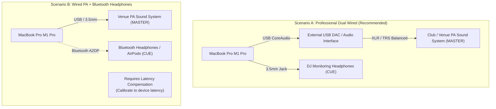

# PulseDeck AI — Event DJ User Manual

> **Product Version:** 0.1.0 (Phase 0 Operational Shell)  
> **Platform:** macOS Sonoma (14.0+) / macOS Sequoia (15.0+), Apple Silicon (M1 Pro / 16GB Baseline)  
> **Target Audience:** Live Performance, Wedding, Corporate, and Event DJs

---

## 1. Welcome to PulseDeck AI

Welcome to **PulseDeck AI**, an intelligent, dual-engine DJ performance workstation engineered from the ground up for Apple Silicon. PulseDeck AI is built to give wedding, event, and club DJs total peace of mind during live sets by combining rock-solid CoreAudio real-time stability with offline audio analysis and an intelligent AI DJ advisor.

### Understanding Operational Phase Status

> [!IMPORTANT]
> **Phase 0 Operational Status:**  
> PulseDeck AI is released in structured phases. The current version ships as **Phase 0 (Operational Foundation)**.
> * **Available Today (Phase 0):** The native SwiftUI dark interface, 10-crate library browser, filesystem scanner, real local test track inspection (`00_Test_Tracks_Dev`), cache schema v1.0.0 definitions, atomic cache persistence, and Python companion validator.
> * **Planned for Subsequent Phases (Phases 1–5):** Real-time CoreAudio playback, dual-device routing, interactive waveforms, automated transitions, Auto-Pilot, soundboard triggers, and external projector displays.
> 
> This manual serves both as your guide to operating the **Phase 0 foundation today** and as your authoritative field manual for upcoming phase releases.

---

## 2. System Requirements & Hardware Setup

### 2.1 Hardware Baseline
* **Computer:** Apple MacBook Pro (14" or 16", Apple Silicon M1 Pro with 16GB Unified Memory or better).
* **Operating System:** macOS Sonoma 14.0 or newer.
* **Storage:** Fast internal SSD for instantaneous waveform and audio streaming.
* **Audio Interfaces:** At least two independent stereo output channels (e.g. built-in 3.5mm jack + USB audio interface).

### 2.2 Live DJ Setup Scenarios



#### Scenario A: Dual Wired Interfaces (Gold Standard for Live Gigs)
* **Master (FOH):** USB Audio Interface (e.g. Focusrite Scarlett, MOTU, or Pioneer DJ interface) connected via USB-C to venue sound mixer.
* **Cue (Headphones):** MacBook Pro built-in 3.5mm headphone jack.
* **Performance:** True low-latency audio ($< 5\,\text{ms}$ buffer latency) with sample-accurate cueing and scratch responsiveness.

#### Scenario B: Wired PA + Bluetooth Headphones (Mobile / Wireless Monitoring)
* **Master (FOH):** USB audio interface or 3.5mm audio jack connected to the room speakers.
* **Cue (Headphones):** Bluetooth wireless headphones (e.g. AirPods Max, Sony WH-1000XM5) paired via macOS Bluetooth.
* **Latency Compensation:** Bluetooth audio introduces variable latency depending on device hardware, codec negotiation, and RF environment. Use the Master/Cue Latency Offset slider in PulseDeck AI to calibrate the Master PA delay until the house sound and headphone cue clicks align perfectly in real time.

> [!WARNING]
> **Bluetooth Audio Limitations & Clock Drift:**  
> Bluetooth audio connections exhibit variable, device-dependent latency and asynchronous hardware clock drift between the host Mac and the wireless receiver. While PulseDeck AI supports Bluetooth headphone cueing with calibration delay compensation, **sample-accurate beatmatching and scratching require a wired CoreAudio connection**.

### 2.3 The Strict No-Microphone Guarantee
PulseDeck AI **never** requests or opens an audio input channel (`engine.inputNode`).
* **Why this matters for your gig:**
  1. Your Bluetooth headphones will **never** be downgraded into low-quality mono telephone mode (HFP/SCO).
  2. You will **never** see an unexpected macOS microphone permission popup in the middle of a set.
  3. There is **zero risk** of an accidental open microphone causing feedback through the venue PA speakers.

---

## 3. Phase 0 Operational Walkthrough (Available Today)

### 3.1 Launching PulseDeck AI
From your terminal workspace:

```bash
# 1. Build the Swift 6 project
swift build

# 2. Run unit tests verifying audio contracts and cache schemas
swift test

# 3. Launch the operational dark UI
swift run PulseDeckAI
```

### 3.2 Navigating the Interface
The Phase 0 operational window is organized into three primary sections:

```
+-----------------------------------------------------------------------------------+
|  [●] PulseDeck AI  [PHASE 0]      Apple Silicon M1 Pro / 16GB   macOS 14+ [Rescan]|
|  LIBRARY: /.../PulseDeck_Library   STATUS: Library Verified: 10 Crates, 7 Tracks  |
+-----------------------------------------------------------------------------------+
|  DJ CRATES (10)            |  00_Test_Tracks_Dev       [7 TRACKS DETECTED]        |
|  ------------------------- |  --------------------------------------------------  |
|  [00] Test Tracks Dev (7)  |  01  Queen - Don't Stop Me Now.mp3  [MEDIA PRESERVED]|
|  [01] Warmup Chill Lounge  |  02  Ed Sheeran - Perfect.mp3        [MEDIA PRESERVED]|
|  [02] Ceremony Slow Rom... |  03  KABÁT - Pohoda.mp3              [MEDIA PRESERVED]|
|  [03] Oldies 70s 80s 90s   |  04  Daft Punk - One More Time.mp3   [MEDIA PRESERVED]|
|  ...                       |  05  ABBA - Gimme! Gimme! Gimme!...  [MEDIA PRESERVED]|
|  [09] Visual Backgrounds   |  ...                                                 |
+-----------------------------------------------------------------------------------+
|  PHASE 0 ARCHITECTURAL CONTRACTS VERIFICATION                                     |
|  [DUAL OUTPUT ENGINES]      [AUDIO-THREAD SAFETY]      [CACHE & AI ADVISOR]       |
|  • Exactly 2 AVAudioEngines • 0 mallocs, 0 locks       • startTrim ≤ vocalEntry...|
|  • Zero inputNode / mic     • Lock-free SPSC buffers   • Manual edits preserved   |
|  • Deck A/B: EQ & Filter    • Latency: -300..+300ms    • Gemini 12 RPM + Ollama   |
+-----------------------------------------------------------------------------------+
```

1. **Status Header & Ribbon:**
   * Displays hardware baseline verification (`Apple Silicon M1 Pro, 16GB Unified Memory`).
   * Displays compiler runtime environment (`macOS 14+ / Swift 6`).
   * Active library root path and scan status message.
   * **[Rescan] Button:** Instantly rescans the filesystem for newly added crates or audio files without restarting the app.
2. **DJ Crates Navigation Panel (Left Column):**
   * Lists the 10 standardized DJ crates.
   * Shows real-time audio file counts and `.gitkeep` presence.
   * Clicking any crate highlights it and loads its contents in the right-hand panel.
3. **Crate Detail & Track Browser (Right Column):**
   * Displays detected audio files with track indices.
   * Displays green `[MEDIA PRESERVED (GIT-IGNORED)]` badges confirming that local audio tracks are active but safely excluded from git repositories.
4. **Architectural Contracts Verification Panel (Bottom Bar):**
   * Real-time verification cards showing the exact operational rules governing audio engines, thread safety, and cache schemas.

### 3.3 Running the Python Cache Companion
PulseDeck AI includes a cross-language Python companion script that validates `.pulsedeck_ai_cache.json` against the schema specification:

```bash
python3 scripts/pulsedeck_cache.py PulseDeck_Library/.pulsedeck_ai_cache.json
```

---

## 4. Planned Audio & DJ Controls (Phases 1–4 Preview)

### 4.1 Dual Deck Signal Chain (Deck A & Deck B)
Each deck features an independent, full-featured DJ channel strip:
* **Transport:** Play, Pause, Cue, Seek, and playhead scrubbing.
* **TimePitch & Key Lock:**
  * Tempo adjustment slider ($\pm 8.0\%$ range, $0.92\text{--}1.08\times$ rate).
  * Key Lock toggle holds original musical key pitch constant during tempo changes.
* **3-Band Equalizer (Isolator):**
  * **Low Shelf ($250\,\text{Hz}$):** Kill the kick/sub bass during mixes ($-24\,\text{dB}$ to $+6\,\text{dB}$).
  * **Mid Parametric ($1200\,\text{Hz}$):** Balance lead vocals and guitars ($-24\,\text{dB}$ to $+6\,\text{dB}$).
  * **High Shelf ($3500\,\text{Hz}$):** Control hi-hat and cymbal presence ($-24\,\text{dB}$ to $+6\,\text{dB}$).
* **Dual-Pole Resonant Sweep Filter:**
  * Turn counter-clockwise from center ($0.0$ to $-1.0$) for Low-Pass Filter sweep.
  * Turn clockwise from center ($0.0$ to $+1.0$) for High-Pass Filter sweep.
  * Resonance ($Q$) knob sharpens the sweep peak for dramatic builds.

### 4.2 Headphone Cue Monitoring & Latency Alignment
* **Pre-Fader Listen (PFL):** Press the `Cue` button on Deck A or Deck B to route audio pre-fader to your headphones while keeping the house output clean.
* **Master/Cue Latency Offset Slider:**
  * Adjusts timing between FOH PA and Headphone Cue from **$-300\,\text{ms}$** to **$+300\,\text{ms}$**.
  * When using Bluetooth headphones, slide toward negative values to delay the house output until it snaps into synchronization with your headphones.

### 4.3 Interactive Waveforms & The Four Bounded Cues (Phase 3)
In Phase 3, PulseDeck AI renders high-contrast multi-band waveforms using SwiftUI Canvas:
* **Waveform Color Coding:**
  * **Red / Amber:** Low frequencies ($20\text{--}250\,\text{Hz}$) — Bass drums, 808 subs, bassline riffs.
  * **Green:** Mid frequencies ($250\text{--}3500\,\text{Hz}$) — Vocals, snare snaps, piano, synths.
  * **Teal / Blue:** High frequencies ($3500\text{--}20000\,\text{Hz}$) — Hi-hats, cymbals, acoustic air.

```
Waveform Overview:
[  Intro Silence  |====== Intro Beat ======|=== Verse 1 (Vocals) ===|=== Outro ===| Trailing Silence ]
                  ▲                         ▲                       ▲             ▲
            startTrimCue              vocalEntryCue              mixOutCue    endTrimCue
```

#### The Four Ordered Cue Markers
1. **`startTrimCue` (Yellow Handle):** Positioned where the first active musical beat drops. When loaded, the deck automatically jumps to this point, skipping vinyl crackle or spoken intros.
2. **`vocalEntryCue` (Green Handle):** Marks the exact second lead vocals start. Used by Auto-Pilot and visual alerts to prevent overlapping vocal clashes.
3. **`mixOutCue` (Red Handle):** The designated mix-out point where the outro transition should start.
4. **`endTrimCue` (Purple Handle):** Trims trailing room silence or audience banter. Playback stops at this point.

#### Setting and Adjusting Cues
* Press `I` to set or snap the `startTrimCue` to the current playhead position.
* Press `O` to set or snap the `mixOutCue` to the current playhead position.
* Drag any cue handle on the waveform with your mouse.
* **AI Trim Bypass Toggle:** Want to hear the original track without automated trim points? Flip the `AI Trim Bypass` switch. The cue points are preserved in the background and can be re-engaged instantly.
* **Human Override Protection:** The moment you move a cue handle manually, PulseDeck AI flags that field as user-adjusted. Future automated scans will **never** overwrite your custom positions.

### 4.4 Automated Performance Transitions (Phase 4)
PulseDeck AI features three transition algorithms accessible via dedicated keyboard shortcuts or the Auto-Pilot engine:

1. **Bass Swap (`B` Key):**
   * *When to use:* Mixing between two house or dance tracks with similar tempos ($\le 6.0\%$ BPM difference).
   * *What it does:* Waits for the downbeat (beat 1), instantly cuts the outgoing track's bass while engaging the incoming track's bass, and smoothly crossfades mid/high frequencies over 16 bars.
2. **Filter Echo Wash (`W` Key):**
   * *When to use:* Transitioning between completely different genres or tempos (e.g. from 128 BPM EDM into 95 BPM Hip-Hop).
   * *What it does:* Sweeps the outgoing deck's high-pass filter upward into an echo wash, executes an equal-power S-curve crossfade, and drops the new track cleanly on the 1.
3. **Hard Cut (`C` Key):**
   * *When to use:* Sudden drops, rock singalongs, or surprise tracks.
   * *What it does:* Snaps to the upcoming bar boundary and cuts instantaneously ($0\,\text{ms}$) from Deck A to Deck B.

### 4.5 Performance Macros: Talkover & Soundboard (Phase 4)
* **Master Talkover Ducking (`T` Key):**
  * Need to make a wedding announcement or bridal party entrance? Press `T`.
  * PulseDeck AI smoothly reduces the master music output **to** approximately 15% of its original linear amplitude (a ~-16.5 dB duck down to 0.15 linear gain) over an 800ms logarithmic curve, while carving a -4.0 dB parametric dip across 300 Hz to 3 kHz. This leaves the backing track subtly audible while providing crystal-clear vocal intelligibility for the MC microphone. Press `T` again to restore full dancefloor volume over 800ms.
* **RAM-Preloaded Soundboard (`F1` through `F8` Keys):**
  * Preloads up to 8 sound effects from `PulseDeck_Library/08_Soundboard_SFX` directly into unified RAM.
  * Press any key from `F1` to `F8` for instant zero-latency drops (air horns, risers, chimes).
  * If a sound file is missing from disk, PulseDeck AI automatically synthesizes a real-time procedural stinger tone so you never get dead air.

---

## 5. Secondary Projector Display & Event Visuals (Phase 5 Preview)

PulseDeck AI includes a dedicated secondary video presentation window designed for external HDMI video projectors, LED walls, or AirPlay screens:

### 5.1 Projector Modes (Keys `1` through `4`)
* **Mode 1 (`Key 1`) — Dynamic Audio Spectrum:** Renders a multi-band FFT audio visualizer that pulses and dances in real time with the master dancefloor sound.
* **Mode 2 (`Key 2`) — Ken Burns Media Slideshow:** Smoothly pans and zooms through high-resolution wedding photos or video loops loaded from `PulseDeck_Library/09_Visual_Backgrounds_Media`.
* **Mode 3 (`Key 3`) — Now Playing & Event Title:** Displays an elegant title card with the currently playing song title, artist, and a customizable event header (e.g. *"Sarah & Michael's Wedding — October 14, 2026"*).
* **Mode 4 (`Key 4`) — Blackout Screen:** Turns the projector display completely black for speeches, formal dinner toasts, or cake cuttings.

### 5.2 Master Deck Safety Lock
* When a deck is actively playing to the Master PA, its transport controls are locked.
* Pressing `Space` (Play/Pause) or scrubbing the active master deck will not stop the music unless you hold `Shift + Space` or toggle the Safety Lock off in the toolbar. This eliminates accidental dancefloor dropouts.

---

## 6. Master Keyboard Shortcuts Map

| Key / Shortcut | Context / Scope | Action Description | Phase |
| :--- | :--- | :--- | :---: |
| **`Space`** | Active Deck | Toggle Play / Pause on selected deck | Phase 1 |
| **`Shift + Space`** | Master Deck | Force Stop / Pause on on-air master deck (overrides safety lock) | Phase 1 |
| **`A`** | System | Select Deck A as active focus deck | Phase 1 |
| **`B`** | System | Select Deck B as active focus deck | Phase 1 |
| **`Q`** | Deck A | Trigger Pre-Fader Cue (PFL) for Deck A | Phase 1 |
| **`W`** | Deck B | Trigger Pre-Fader Cue (PFL) for Deck B | Phase 1 |
| **`I`** | Waveform | Set `startTrimCue` to current playhead position | Phase 3 |
| **`O`** | Waveform | Set `mixOutCue` to current playhead position | Phase 3 |
| **`Y`** | Waveform | Toggle `aiTrimBypass` on active deck | Phase 3 |
| **`Left / Right Arrow`**| Waveform | Scrub playhead forward / backward by 1 beat | Phase 3 |
| **`Shift + Left / Right`**| Waveform | Scrub playhead forward / backward by 1 bar (4 beats) | Phase 3 |
| **`B` (Transition Mode)**| Crossfader | Execute bar-aligned **Bass Swap Transition** | Phase 4 |
| **`W` (Transition Mode)**| Crossfader | Execute **Filter Echo Wash Transition** | Phase 4 |
| **`C`** | Crossfader | Arm and trigger bar-aligned **Hard Cut Transition** | Phase 4 |
| **`Shift + A`** | Automation | Toggle **Auto-Pilot** automated mix engine | Phase 4 |
| **`T`** | Master Bus | Toggle **Master Talkover Ducking** (reduces master to ~15% linear amplitude over 800ms + mid-dip) | Phase 4 |
| **`F1` – `F8`** | Soundboard | Trigger RAM-preloaded sound effects (1 through 8) | Phase 4 |
| **`1`** | Projector | Switch Projector to **Mode 1: Audio Spectrum Visualizer** | Phase 5 |
| **`2`** | Projector | Switch Projector to **Mode 2: Ken Burns Media Slideshow** | Phase 5 |
| **`3`** | Projector | Switch Projector to **Mode 3: Now Playing / Event Title** | Phase 5 |
| **`4`** | Projector | Switch Projector to **Mode 4: Blackout / Idle Logo** | Phase 5 |
| **`Cmd + R`** | Library | Rescan music library crates and refresh cache | Phase 0 |

---

## 7. AI DJ Advisor Setup & Google AI Studio Key Handling

PulseDeck AI features a hybrid recommendation engine that suggests harmonious track transitions based on Camelot key compatibility, energy progression, and song structure.

### 7.1 Cloud Advisor Configuration (Google Gemini 2.5 Flash)
The cloud advisor uses Google's `gemini-2.5-flash` model:
1. **Get an API Key:** Sign in to [Google AI Studio](https://aistudio.google.com/) and create a free or paid API key.
2. **Configure Your Environment:** Set your API key in your terminal shell profile (`~/.zshrc`):
   ```bash
   export GEMINI_API_KEY="your-actual-api-key-here"
   ```
3. **Security Guarantee:** PulseDeck AI **never** commits your API key to git repositories or stores it in `.pulsedeck_ai_cache.json`. The key is read directly from process environment variables at runtime.

### 7.2 Rate Limits & Provider Quota Disclaimer
* **Rate Limit Ceiling:** PulseDeck AI strictly enforces a client-side rate limit of **12 Requests Per Minute** (minimum $5.0\,\text{s}$ between calls).
* **Automatic Backoff:** In the event of network turbulence or HTTP 429 quota exhaustion, the engine automatically applies exponential backoff with random jitter ($1.0\,\text{s}$ up to $30.0\,\text{s}$, maximum 3 retries).
* **Local Fingerprint Caching:** Results are cached by track audio fingerprints; previously analyzed song pairs are loaded instantly without making new network calls.

> [!NOTE]
> **API Availability & Free Tier Disclaimer:**  
> Free tier quotas, model availability, and pricing terms are determined exclusively by Google AI Studio and may vary over time. PulseDeck AI does **not** rely on cloud availability to perform: local Accelerate vDSP acoustic analysis and all playback capabilities function 100% offline.

### 7.3 Offline Local Advisor Fallback (Ollama)
For venues with zero cellular or Wi-Fi coverage:
1. Install [Ollama](https://ollama.com/) on your Mac (`brew install ollama`).
2. Pull a local model:
   ```bash
   ollama pull llama3
   ```
3. Ensure the Ollama daemon is running at `http://localhost:11434`.
4. If no Gemini API key is configured or network drops occur, PulseDeck AI automatically routes transition queries to your local Ollama daemon without interruption.

---

## 8. DJ Library Organization & Media Management

### 8.1 The 10 Standardized Crates
PulseDeck AI organizes your library into 10 structured folders under `PulseDeck_Library/`. Keep folder names unchanged for seamless operation:

```
PulseDeck_Library/
├── 00_Test_Tracks_Dev/             # Benchmark test songs (Queen, Daft Punk, ABBA, etc.)
├── 01_Warmup_Chill_Lounge/         # Cocktail hour, lo-fi, acoustic, ambient background
├── 02_Ceremony_Slow_Romantic/      # Wedding walk-in, first dance, slow waltzes, ballads
├── 03_Oldies_70s_80s_90s/          # Retro pop, disco, funk, classic party anthems
├── 04_CZ_SK_Classics/              # Czech & Slovak celebration hits (Kabát, Elán, etc.)
├── 05_MainStage_Dance_120_128BPM/  # Peak-time club, EDM, festival house (120-128 BPM)
├── 06_2000s_Millennium_Hits/       # Y2K pop, 2000s R&B, hip-hop throwback bangers
├── 07_Rock_PopPunk_LateNight/      # Energetic rock, guitar singalongs, late-night anthems
├── 08_Soundboard_SFX/              # Airhorns, sweeps, countdowns, wedding entrance bells
└── 09_Visual_Backgrounds_Media/    # High-resolution video loops and event background photos
```

### 8.2 Supported Audio Formats
PulseDeck AI supports all major uncompressed and compressed audio formats through CoreAudio:
* Uncompressed / Lossless: `.wav`, `.aif`, `.aiff`, `.flac`, `.m4a` (ALAC)
* Compressed: `.mp3`, `.aac`, `.ogg`, `.mp4`

### 8.3 Git Exclusions & Media Privacy
Audio tracks in `PulseDeck_Library` are strictly excluded from version control via `.gitignore`. Your copyrighted music files and client wedding media will **never** be committed or published.

---

## 9. Troubleshooting & DJ Pre-Flight Checklist

### 9.1 Troubleshooting Guide

| Issue Encountered | Probable Cause | Actionable Resolution |
| :--- | :--- | :--- |
| **Audio out of sync between headphones and PA** | Variable wireless headphone latency | Adjust the Master/Cue Latency Offset slider to inject delay into the master output until cue clicks align with the room. |
| **Headphones sound tinny / low bandwidth** | App accessed `inputNode` or microphone | Verify you are running PulseDeck AI (which strictly disables `inputNode`). Check macOS Sound settings to ensure microphone input is set to Internal Mic, not Bluetooth headset. |
| **New audio files not showing in Crate** | Filesystem cache not refreshed | Click the **[Rescan]** button in the top status header or press `Cmd + R`. |
| **AI Advisor returns error / no suggestions** | Missing API key or offline venue | Verify `GEMINI_API_KEY` in terminal, or start local Ollama (`ollama serve`) on `localhost:11434`. |
| **Cues reset to default positions** | Manual override flag was cleared | Ensure `manualOverrides.isManual = true` in the cache file. Manual edits made via `I` and `O` are automatically protected. |

### 9.2 The 15-Minute DJ Pre-Flight Checklist
Before opening the room to guests:
1. **Power & Hardware:** Connect MacBook Pro to MagSafe power. Connect USB DAC interface to PA system and verify signal lights.
2. **Headphone Check:** Plug headphones into 3.5mm jack (or pair Bluetooth headphones). Run a test track in `00_Test_Tracks_Dev` and verify pre-fader cueing (`Q` key).
3. **Latency Calibration:** If using Bluetooth headphones, adjust latency offset until cue clicks align with master output.
4. **Projector Screen:** Connect HDMI cable to external projector. Press `Key 1` to confirm audio visualizer and `Key 3` to verify wedding couple's name card.
5. **Soundboard Test:** Press `F1` to verify airhorn / entrance stinger volume.
6. **Engage Safety Lock:** Verify Master Safety Lock is engaged to prevent accidental pauses during the event.
