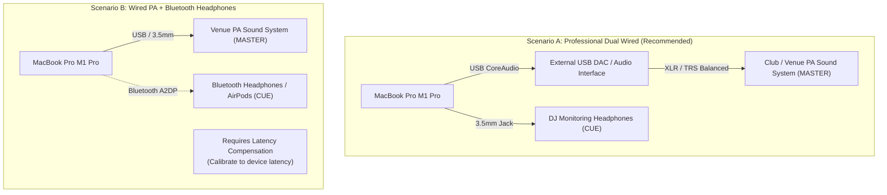

# PulseDeck AI — Event DJ User Manual

> **Platform:** macOS Sonoma (14.0+) / macOS Sequoia (15.0+), Apple Silicon (M1 Pro / 16GB Baseline)  
> **Target Audience:** Live Performance, Wedding, Corporate, and Event DJs

---

## 1. Welcome to PulseDeck AI

Welcome to **PulseDeck AI**, an intelligent, dual-engine DJ performance workstation engineered from the ground up for Apple Silicon. PulseDeck AI is built to give wedding, event, and club DJs total peace of mind during live sets by combining rock-solid CoreAudio real-time stability with offline audio analysis, automated performance transitions, an 8-pad RAM soundboard, secondary video projector visuals, and an intelligent AI DJ advisor.

### System Verification & Delivery Status

PulseDeck AI delivers a complete, verified DJ workstation:
* **Dual Output Engines:** Segregated CoreAudio output pipelines for Master Front-of-House (FOH) and Cue (Headphones) monitoring without aggregate device configuration.
* **Strict Output-Only Guarantee:** Zero access to `engine.inputNode`, eliminating microphone permission prompts, Bluetooth audio codec degradation, and acoustic feedback risks.
* **Real-Time Thread Safety:** Render callbacks execute without heap allocations (`malloc`), locks, mutexes, Swift runtime actor hops, or Objective-C ARC retain/release cycles.
* **Deterministic Cache & Human DJ Provenance:** High-precision automated DSP cue analysis backed by atomic file persistence that never clobbers manual user adjustments.
* **Performance Macro Automation:** Bar-aligned transitions (Bass Swap, Filter Echo Wash, Hard Cut), Auto-Pilot state machine, Master talkover ducking (`T`), and RAM-preloaded soundboard (`F1`–`F8`).
* **Secondary Projector Visuals:** Dedicated presentation window (`Cmd + Shift + P`) offering 24-band FFT spectrum visualizer, Ken Burns photo slideshow and muted video loops, Now Playing card with event banner, and blackout screen.
* **Master Deck Safety Lock:** Default-on transport guard protecting active on-air decks on the audio control queue from accidental drops, with `Shift + Space` one-shot override (merged in PR #19).

---

## 2. System Requirements & Hardware Setup

### 2.1 Hardware Baseline
* **Computer:** Apple MacBook Pro (14" or 16", Apple Silicon M1 Pro with 16GB Unified Memory or better).
* **Operating System:** macOS Sonoma 14.0 or newer (macOS 15 Sequoia supported).
* **Storage:** Fast internal SSD for instantaneous waveform display and audio streaming.
* **Audio Interfaces:** At least two independent stereo output channels (e.g. built-in 3.5mm jack + external USB audio interface).
* **Video Output:** Built-in display + secondary external HDMI / USB-C DisplayPort / AirPlay display for audience visuals.

### 2.2 Live DJ Setup Scenarios



#### Scenario A: Dual Wired Interfaces (Gold Standard for Live Gigs)
* **Master (FOH):** USB Audio Interface (e.g. Focusrite Scarlett, MOTU, or Pioneer DJ interface) connected via USB-C to venue sound mixer.
* **Cue (Headphones):** MacBook Pro built-in 3.5mm headphone jack.
* **Performance:** True low-latency audio ($< 5\,\text{ms}$ buffer latency) with sample-accurate cueing and scratch responsiveness.

#### Scenario B: Wired PA + Bluetooth Headphones (Mobile / Wireless Monitoring)
* **Master (FOH):** USB audio interface or 3.5mm audio jack connected to the room speakers.
* **Cue (Headphones):** Bluetooth wireless headphones (e.g. AirPods Max, Sony WH-1000XM5) paired via macOS Bluetooth.
* **Latency Compensation:** Bluetooth audio introduces variable latency depending on device hardware, codec negotiation, and RF environment. Use the Master/Cue Latency Offset slider in PulseDeck AI to calibrate the Master PA delay until house sound and headphone cue clicks align perfectly.

> [!WARNING]
> **Bluetooth Audio Limitations & Clock Drift:**  
> Bluetooth audio connections exhibit variable, device-dependent latency and asynchronous hardware clock drift between the host Mac and the wireless receiver. While PulseDeck AI supports Bluetooth headphone cueing with calibration delay compensation, **sample-accurate beatmatching and scratching require a wired CoreAudio connection**.

### 2.3 The Strict No-Microphone Guarantee
PulseDeck AI **never** requests or opens an audio input channel (`engine.inputNode`).
* **Why this matters for your gig:**
  1. Your Bluetooth headphones will **never** be downgraded into low-quality mono telephone mode (HFP/SCO @ 8kHz/16kHz).
  2. You will **never** see an unexpected macOS microphone permission popup in the middle of a live set.
  3. There is **zero risk** of an accidental open microphone causing feedback loops through the venue PA speakers.

---

## 3. Performance Studio Interface Walkthrough

```
+---------------------------------------------------------------------------------------------------+
|  [●] PulseDeck AI        Apple Silicon M1 Pro / 16GB   macOS 14+                [Rescan (Cmd+R)]  |
|  LIBRARY: /.../PulseDeck_Library   STATUS: 10 Crates, 7 Tracks Verified                           |
+---------------------------------------------------------------------------------------------------+
|  DECK A (Teal)                     |  CENTRAL MIXER & CONTROLS         |  DECK B (Amber)          |
|  Queen - Don't Stop Me Now         |  Master Vol: [====|====] 0.0 dB   |  Daft Punk - One More... |
|  156.0 BPM • 11B • Key Lock: ON    |  Crossfader: [====|====] Center   |  123.0 BPM • 8B • Lock: ON|
|  [PLAY] [CUE] [PAUSE]  Speed: 0.0% |  [TALK (T)] [AUTO-PILOT] [LOCK]   |  [PLAY] [CUE] [PAUSE]    |
|  EQ: Low 0.0 | Mid 0.0 | High 0.0  |  TRANSITIONS: [BASS] [WASH] [CUT] |  EQ: Low 0.0 | Mid | High|
|  Filter: 0.0 (Center)  Res: 1.0    |  METERS: Master -12dB | Cue -14dB |  Filter: 0.0  Res: 1.0   |
|  [WAVEFORM CANVAS - 4 CUE HANDLES] |  SOUNDBOARD SFX (F1 - F8):        |  [WAVEFORM CANVAS]       |
|  startTrim ▲ vocal ▲ mixOut ▲ end  |  [F1 Pip] [F2 Kick] [F3 Snare]... |  startTrim ▲ vocal ▲ ... |
+---------------------------------------------------------------------------------------------------+
|  DJ CRATES (10)            |  TRACK BROWSER: 05_MainStage_Dance_120_128BPM                        |
|  ------------------------- |  Ref Deck: [Deck A ▼] • Compatibility: Camelot Harmonic & Tempo      |
|  [00] Test Tracks Dev (7)  |  01  Avicii - Levels.mp3         126 BPM  4B  [EXACT KEY] [TEMPO OK] |
|  [01] Warmup Chill Lounge  |  02  Calvin Harris - Summer.mp3  128 BPM  4B  [EXACT KEY] [TEMPO OK] |
|  [05] MainStage Dance (12) |  03  Tiësto - The Business.mp3   120 BPM  5A  [ADJACENT]  [TEMPO OK] |
|  ...                       |  [AUDITION CUE BAR] [▶ Play] [■ Stop] Scrub: [===|===] [|◀] [▶|]     |
+---------------------------------------------------------------------------------------------------+
```

### 3.1 Top Status Header & Library Rescanning
* **Hardware & Runtime Validation:** Displays verified Apple Silicon architecture, memory profile, and Swift 6 concurrency runtime.
* **Library Status:** Reports crate discovery, track counts, and validation status.
* **Rescan Button (`Cmd + R`):** Triggers an asynchronous, non-blocking scan of `PulseDeck_Library`. Newly added crates or audio files appear immediately without restarting the application.

### 3.2 Crates Browser & Harmonic Compatibility Badges
* **10 Standard DJ Crates:** Structured navigation across wedding and event crates (see Section 8).
* **Reference Deck Selector:** Toggle between **Deck A** and **Deck B** as the harmonic mixing reference.
* **Compatibility Badges:**
  * **Camelot Key Badges:** `EXACT KEY` (matching key number and letter), `RELATIVE` (same number, opposite letter e.g. 8A to 8B), `ADJACENT` (±1 Camelot number e.g. 8A to 7A/9A), or `CLASH` (incompatible musical key). Tracks with unknown tempo/key display honest `UNKNOWN` indicators.
  * **Tempo Badges:** Tracks within $\le 6.0\%$ tempo difference display `TEMPO OK`; larger differences show relative differential percentage.

### 3.3 Headphone Cue Audition Bar (Cue Preview)
* Dedicated preview player wired directly to the Headphone Cue audio engine (`CuePreviewPlayer`).
* **Zero Master Leakage:** Audition playback routes exclusively to DJ headphones; zero preview audio ever reaches Master FOH speakers.
* **Controls:** Play/Pause (`Space` when audition bar is focused), Stop, continuous slider scrubbing, and beat/bar step buttons (`[|◀]`, `[▶|]`). Beat step is disabled for unanalyzed tracks or unknown tempo sentinels.

### 3.4 Dual Deck DJ Channel Strips (Deck A & Deck B)
* **Transport:** Bounded Play, Pause, Cue, and Seek controls.
* **TimePitch & Key Lock:**
  * Variable pitch/tempo adjustment slider ($\pm 8.0\%$ range, $0.92\text{--}1.08\times$ rate).
  * Key Lock toggle maintains musical pitch during tempo adjustments.
* **3-Band Isolator Equalizer:**
  * Low Shelf ($250\,\text{Hz}$): Kill or boost kick and bass ($-24\,\text{dB}$ to $+6\,\text{dB}$).
  * Mid Parametric ($1200\,\text{Hz}$): Shape vocals and instruments ($-24\,\text{dB}$ to $+6\,\text{dB}$).
  * High Shelf ($3500\,\text{Hz}$): Control hi-hat and cymbal brightness ($-24\,\text{dB}$ to $+6\,\text{dB}$).
* **Dual-Pole Resonant Sweep Filter:**
  * Turn counter-clockwise from center ($0.0$ to $-1.0$) for smooth Low-Pass Filter sweep.
  * Turn clockwise from center ($0.0$ to $+1.0$) for High-Pass Filter sweep.
  * Resonance ($Q$) knob shapes sweep sharpness and acoustic energy.

### 3.5 Interactive Canvas Waveforms & Cue Editing
Each deck features a 60 FPS multi-band waveform rendered with SwiftUI Canvas:
* **Frequency Band Colors:**
  * **Red / Amber:** Low frequencies ($20\text{--}250\,\text{Hz}$) — Kick drums, basslines, 808 subs.
  * **Green:** Mid frequencies ($250\text{--}3500\,\text{Hz}$) — Vocals, snare snaps, pianos, guitars.
  * **Teal / Blue:** High frequencies ($3500\text{--}20000\,\text{Hz}$) — Hi-hats, cymbals, acoustic presence.
* **The Four Ordered Cue Markers:**
  1. `startTrimCue` (Yellow Handle): Automatically loaded starting position, skipping dead space or ambient intro banter. Set via `I` key.
  2. `vocalEntryCue` (Green Handle): First lead vocal entry. Used by Auto-Pilot to prevent vocal clashes.
  3. `mixOutCue` (Red Handle): Optimal transition start marker. Set via `O` key.
  4. `endTrimCue` (Purple Handle): Trailing silence cutoff. Playback automatically stops here.
* **AI Trim Bypass Toggle (`Y` Key):** Disables automated trim cues to audition the original unedited track length without losing cue positions.
* **Human Override Protection:** Dragging cue handles flags fields as user-customized in `.pulsedeck_ai_cache.json`. Rescanning will **never** overwrite your custom cue adjustments.

> [!IMPORTANT]
> **Non-Destructive Cue Editing:** Moving cue handles or scrubbing the playhead in the waveform editor is strictly non-destructive. The cue editor playhead does **not** seek live playing Master audio.

### 3.6 Automated Performance Transitions
Accessible via the mixer interface or keyboard hotkeys:
* **Bass Swap (`B` Key):** Waits for the next downbeat (beat 1), instantly cuts outgoing bass while swapping incoming bass, and smoothly crossfades mid/high frequencies over 16 bars.
* **Filter Echo Wash (`W` Key):** Sweeps outgoing deck's high-pass filter upward into an echo wash, executes an equal-power S-curve crossfade, and drops the incoming track on the downbeat.
* **Hard Cut (`C` Key):** Quantizes to the upcoming bar boundary and cuts instantaneously ($0.0\,\text{ms}$) from Deck A to Deck B.
* **Auto-Pilot (`Shift + A`):** When the playhead crosses `mixOutCue`, Auto-Pilot evaluates harmonic compatibility, selects the optimal transition type, and executes the mix automatically.

### 3.7 Master Talkover Ducking (`T` Key)
* Press `T` to make an announcement over the MC microphone.
* **Linear 800ms Duck:** Smoothly attenuates Master FOH music **to** 15% linear amplitude (0.15 multiplier, ~-16.5 dB) over an 800ms linear ramp.
* **Vocal Pocket EQ:** Carves a -4.0 dB parametric notch across 300 Hz to 3 kHz on the master bus, leaving the backing track subtly present while maximizing vocal clarity.
* Press `T` again to restore full dancefloor volume over an 800ms linear ramp.
* **SFX Bypass:** Master-only Soundboard drops bypass the ducking bus downstream, remaining full-volume and punchy during announcements.

### 3.8 RAM-Preloaded Soundboard (`F1` through `F8` Keys)
* Preloads up to 8 sound effects from `PulseDeck_Library/08_Soundboard_SFX` in alphabetical order directly into unified RAM.
* **Zero-I/O Trigger Path:** Audio files are pre-decoded and converted to canonical 44.1 kHz, 32-bit Float, stereo buffers off the render path during startup. Triggering a pad performs zero disk I/O, zero decoding, and zero buffer allocations.
* **Procedural Synthesized Fallbacks:** Missing, corrupt, unsupported, or oversized (>15s / 12MB) files safely substitute pre-synthesized musical procedural buffers (1 kHz stinger, 808 sub kick, noise snare, chime, rimshot, siren, laser zap, airhorn triad).
* **Polyphonic & Choke-Self Retrigger:** Independent pads overlap polyphonically without cutting each other or deck playback off. Retriggering the same active pad cuts and restarts that pad monophonically (choke self) to enable stutter performance effects.
* **Audio Routing:** Soundboard routes exclusively to Master FOH sound. Headphone Cue receives zero SFX signal.
* **macOS Function Key Behavior:** On Apple keyboards, macOS defaults function keys to system controls (brightness, media). Trigger Soundboard pads by holding `Fn` (or Globe) while pressing `F1`–`F8`, or enable *"Use F1, F2, etc. keys as standard function keys"* in macOS System Settings > Keyboard > Keyboard Shortcuts > Function Keys.

---

## 4. Secondary Projector Display & Event Visuals (Phase 5A)

PulseDeck AI provides a dedicated secondary video presentation window designed for external HDMI video projectors, LED walls, or AirPlay displays:

### 4.1 Opening & Managing the Projector Window
* **Open / Close Projector:** Press `Cmd + Shift + P` or choose **Projector > Open Projector Window**. PulseDeck AI automatically detects connected external displays via `NSScreen` and positions the window on the external screen. If disconnected, it falls back safely to the primary display.
* **Toggle Fullscreen:** Press `Cmd + Ctrl + F` or choose **Projector > Toggle Fullscreen**.
* **Display Disconnect Safety:** If an external HDMI cable is unplugged during a set, PulseDeck AI listens for `NSApplication.didChangeScreenParametersNotification` and repositions windows without interrupting audio playback or transport.

### 4.2 Projector Modes (Keys `1` through `4`)
* **Mode 1 (`Key 1`) — Dynamic Audio Spectrum:** Renders a 24-band FFT audio visualizer responding dynamically to Master dancefloor sound. Consumes published output meter frames with zero audio real-time allocations, decaying smoothly on silence without random noise.
* **Mode 2 (`Key 2`) — Ken Burns Media Slideshow & Video Loops:** Smoothly pans and zooms through photos (JPG, PNG, HEIC, WEBP, TIFF) or plays looping videos (MP4, MOV, M4V) from `PulseDeck_Library/09_Visual_Backgrounds_Media`. Features bounded discovery, thumbnail downsampling (48 MB / 20 photo RAM cache), and honest idle fallback.
  * **Strictly Muted Videos:** Video playback is strictly muted (`isMuted = true`, `volume = 0.0`), guaranteeing zero audio leakage into Master PA or Headphone Cue.
* **Mode 3 (`Key 3`) — Now Playing & Event Title:** Displays an elegant title card with active track title, artist, BPM, musical key, and a customizable event banner (e.g. *"Sarah & Michael's Wedding — October 14, 2026"*).
* **Mode 4 (`Key 4`) — Blackout Screen:** Turns the projector display completely black (`Color.black`) for speeches, dinner toasts, or formal moments, leaving DJ booth controls and audio completely uninterrupted.

### 4.3 Context-Sensitive Keyboard Routing
* Keys 1–4 switch projector modes when the projector window is open.
* **First-Responder Text Protection:** When editing event banner text or typing into any text field (`NSTextField`, `NSTextView`), digits 1–4 are passed directly to text input and are **never** stolen by the projector router.
* Repeat suppression drops held-key repeats; rapid multi-route dispatches within 120 ms are safely debounced.

---

## 5. Master Deck Safety Lock

To prevent accidental dancefloor silence during live sets:
* **Default-On Protection:** Enabled by default upon app startup. Protects any loaded deck actively playing to a running Master engine with nonzero channel or crossfader gain.
* **Control-Queue Graph Authority:** On-air status is evaluated synchronously on the audio control queue against real graph state, protecting both decks simultaneously during crossfades.
* **Guarded Actions:** Manual pause, stop, track replacement/load, and live playhead seek commands are intercepted and rejected with nonmodal warning feedback while locked.
* **One-Shot Override (`Shift + Space`):** Pressing `Shift + Space` allows an intentional one-shot pause of the focused on-air deck without clearing the persistent lock state.
* **Automation & Cue Exceptions:** Automated transitions, headphone Cue audition, and non-destructive waveform cue editing are completely exempt from manual transport locking.

---

## 6. Master Keyboard Shortcuts Map

| Key / Shortcut | Scope / Context | Action Description | Phase |
| :--- | :--- | :--- | :---: |
| **`Space`** | Studio Deck | Toggle Play / Pause on selected deck (guarded when on-air and locked) | Phase 1 / 5A |
| **`Shift + Space`** | Studio Deck | One-shot Force Pause on on-air master deck (overrides safety lock) | Phase 5A |
| **`Space`** | Audition Bar | Toggle preview Play / Pause (when audition bar is focused) | Phase 3B |
| **`A`** | Studio | Select Deck A as active focus deck | Phase 1 |
| **`B`** | Studio | Select Deck B as active focus deck | Phase 1 |
| **`Q`** | Deck A | Trigger Pre-Fader Cue (PFL) for Deck A | Phase 1 |
| **`W`** | Deck B | Trigger Pre-Fader Cue (PFL) for Deck B | Phase 1 |
| **`I`** | Waveform | Snap `startTrimCue` to current waveform playhead position | Phase 3A |
| **`O`** | Waveform | Snap `mixOutCue` to current waveform playhead position | Phase 3A |
| **`Y`** | Waveform | Toggle `aiTrimBypass` on active deck | Phase 3A |
| **`Left / Right Arrow`** | Waveform | Nudge selected cue handle forward / backward | Phase 3A |
| **`[|◀] / [▶|]`** | Audition Bar | Step preview playhead 1 beat (audition focused) | Phase 3B |
| **`Shift + Left / Right`**| Audition Bar | Step preview playhead 4 beats / 1 bar (disabled for sentinels) | Phase 3B |
| **`B`** (Transition Mode) | Crossfader | Execute bar-aligned **Bass Swap Transition** | Phase 4A |
| **`W`** (Transition Mode) | Crossfader | Execute **Filter Echo Wash Transition** | Phase 4A |
| **`C`** | Crossfader | Arm and execute bar-aligned **Hard Cut Transition** | Phase 4A |
| **`Shift + A`** | Automation | Toggle **Auto-Pilot** automated mix engine | Phase 4A |
| **`T`** | Master Bus | Toggle **Master Talkover Ducking** (800ms linear duck to 0.15 gain + mid dip) | Phase 4B |
| **`F1` – `F8`** | Soundboard | Trigger RAM Soundboard pads 1–8 (hold `Fn`/Globe if macOS standard keys disabled) | Phase 4B |
| **`1`** | Projector | Switch Projector to **Mode 1: Audio Spectrum Visualizer** | Phase 5A |
| **`2`** | Projector | Switch Projector to **Mode 2: Ken Burns Media Slideshow** | Phase 5A |
| **`3`** | Projector | Switch Projector to **Mode 3: Now Playing / Event Title** | Phase 5A |
| **`4`** | Projector | Switch Projector to **Mode 4: True Blackout Screen** | Phase 5A |
| **`Cmd + Shift + P`** | Window | Open / Close Secondary Projector Window | Phase 5A |
| **`Cmd + Ctrl + F`** | Projector | Toggle Fullscreen on active Projector Window | Phase 5A |
| **`Cmd + R`** | Library | Rescan music library crates and refresh cache asynchronously | Phase 0 |

---

## 7. AI DJ Advisor Setup & Google AI Studio Key Handling

PulseDeck AI features a hybrid recommendation engine suggesting transitions based on Camelot key compatibility, energy progression, and song structure.

### 7.1 Cloud Advisor Configuration (Google Gemini 2.5 Flash)
The cloud advisor defaults to Google's `gemini-2.5-flash` model. Model and HTTPS endpoint are configurable; the client does not silently substitute another model.
1. **Get an API Key:** Sign in to [Google AI Studio](https://aistudio.google.com/) and create an API key.
2. **Configure Your Environment:** Set your API key in your terminal shell profile (`~/.zshrc`):
   ```bash
   export GEMINI_API_KEY="your-actual-api-key-here"
   ```
3. **Security Guarantee:** PulseDeck AI **never** commits your API key to git repositories or stores it in `.pulsedeck_ai_cache.json`. The key is read from the process environment variable at runtime and sent only in Google's `x-goog-api-key` header, never in URLs or log files.

### 7.2 Rate Limits & Provider Quota Disclaimer
* **Rate Limit Ceiling:** PulseDeck AI strictly enforces **12 cloud HTTP attempts in any rolling 60 seconds**, including retries and concurrent callers.
* **Automatic Backoff:** Transient network errors use at most 3 retries, honoring `Retry-After` up to 30 seconds.
* **Local In-Memory Cache:** Valid recommendations use a bounded in-memory cache. No cloud recommendation is written to the persistent file cache.

> [!NOTE]
> **API Availability Disclaimer:**  
> Free tier quotas, model availability, and pricing terms are determined exclusively by Google AI Studio. Core playback and local analysis do **not** require cloud access.

### 7.3 Offline Local Advisor Fallback (Ollama)
For venues with zero cellular or Wi-Fi coverage:
1. Install [Ollama](https://ollama.com/) on your Mac (`brew install ollama`).
2. Pull a local model:
   ```bash
   ollama pull llama3
   ```
3. Ensure the Ollama daemon is running at `http://localhost:11434`.
4. If no Gemini API key is configured or a cloud request fails, PulseDeck AI tries the local Ollama daemon. If Ollama is unavailable, the advisor returns a bounded error; playback and offline analysis continue uninterrupted.

### 7.4 Offline Batch Library Analysis
Preview analysis without writing files:
```bash
python3 -m pip install -r requirements-analysis.txt
python3 scripts/analyze_library.py --library-root PulseDeck_Library --cache PulseDeck_Library/.pulsedeck_ai_cache.json --dry-run
```
To write a validated schema v1 cache copy, specify an explicit output path outside the library:
```bash
python3 scripts/analyze_library.py --library-root PulseDeck_Library --cache PulseDeck_Library/.pulsedeck_ai_cache.json --output-cache /tmp/pulsedeck-analysis.json
```

---

## 8. DJ Library Organization & Supported Media Formats

### 8.1 The 10 Standardized Crates
PulseDeck AI organizes your library into 10 structured folders under `PulseDeck_Library/`. Keep folder names unchanged for seamless operation:

```
PulseDeck_Library/
├── 00_Test_Tracks_Dev/             # Benchmark test songs (Queen, Daft Punk, ABBA, etc.)
├── 01_Warmup_Chill_Lounge/         # Cocktail hour, lo-fi, acoustic, ambient background
├── 02_Ceremony_Slow_Romantic/      # Wedding walk-in, first dance, slow waltzes, ballads
├── 03_Oldies_70s_80s_90s/          # Retro pop, disco, funk, classic party anthems
├── 04_CZ_SK_Classics/              # Czech & Slovak celebration hits (Kabát, Elán, etc.)
├── 05_MainStage_Dance_120_128BPM/  # Peak-time club, EDM, festival house (120-128 BPM)
├── 06_2000s_Millennium_Hits/       # Y2K pop, 2000s R&B, hip-hop throwback bangers
├── 07_Rock_PopPunk_LateNight/      # Energetic rock, guitar singalongs, late-night anthems
├── 08_Soundboard_SFX/              # Airhorns, sweeps, countdowns, wedding entrance bells
└── 09_Visual_Backgrounds_Media/    # High-resolution video loops and event background photos
```

### 8.2 Supported Audio & Video Formats
* **Audio:** `.wav`, `.aif`, `.aiff`, `.flac`, `.m4a` (ALAC/AAC), `.mp3`, `.aac`, `.ogg`, `.mp4`
* **Projector Photos:** `.jpg`, `.jpeg`, `.png`, `.heic`, `.webp`, `.tiff`
* **Projector Videos:** `.mp4`, `.mov`, `.m4v` (strictly muted playback)

### 8.3 Git Exclusions & Media Privacy
Audio and video files in `PulseDeck_Library` are strictly excluded from version control via `.gitignore`. Copyrighted music and private client photos/videos are never committed or published.

---

## 9. Troubleshooting & DJ Pre-Flight Checklist

### 9.1 Troubleshooting Guide

| Issue Encountered | Probable Cause | Actionable Resolution |
| :--- | :--- | :--- |
| **Audio out of sync between headphones and PA** | Variable wireless headphone latency | Adjust the Master/Cue Latency Offset slider in Output Routing to inject delay into the master output until cue clicks align with room sound. |
| **Headphones sound tinny / low bandwidth** | App accessed `inputNode` or microphone | Verify you are running PulseDeck AI (which strictly disables `inputNode`). Check macOS Sound settings to ensure microphone input is set to Internal Mic, not Bluetooth headset. |
| **New audio files not showing in Crate** | Filesystem cache not refreshed | Click the **[Rescan]** button in the top status header or press `Cmd + R`. |
| **AI Advisor returns error / no suggestions** | Missing API key or offline venue | Verify `GEMINI_API_KEY` in terminal, or start local Ollama (`ollama serve`) on `localhost:11434`. |
| **Cues reset to default positions** | Manual override flag was cleared | Ensure `manualOverrides.isManual = true` in cache file. Manual edits made via `I`/`O` or handle dragging are automatically protected. |
| **Soundboard pads do not trigger with F1–F8** | macOS Function Key system mapping | Hold `Fn` (or Globe) while pressing `F1`–`F8`, or enable standard function keys in macOS System Settings > Keyboard > Function Keys. |
| **Projector window opens on laptop display** | External HDMI display not detected | Connect HDMI cable, verify display in macOS Displays settings, and press `Cmd + Shift + P` to reopen projector window. |
| **Deck transport buttons do not respond** | Master Deck Safety Lock is engaged | If deck is on-air to Master, use `Shift + Space` to pause, or toggle Safety Lock off in mixer toolbar. |

### 9.2 The 15-Minute DJ Pre-Flight Checklist
Before opening the room to guests:
1. **Power & Hardware:** Connect MacBook Pro to MagSafe power. Connect USB DAC interface to PA system and verify signal lights.
2. **Headphone Check:** Plug headphones into 3.5mm jack (or pair Bluetooth headphones). Run a test track in `00_Test_Tracks_Dev` and verify pre-fader cueing (`Q` key).
3. **Latency Calibration:** If using Bluetooth headphones, adjust latency offset until cue clicks align with master output.
4. **Projector Screen:** Connect HDMI cable to external projector. Press `Cmd + Shift + P`. Press `Key 1` to verify audio spectrum visualizer and `Key 3` to verify wedding couple's name card.
5. **Soundboard Test:** Press `F1` (or `Fn + F1`) to verify stinger / airhorn volume through venue PA.
6. **Engage Safety Lock:** Verify Master Safety Lock is engaged in the central mixer to prevent accidental pauses during the event.
